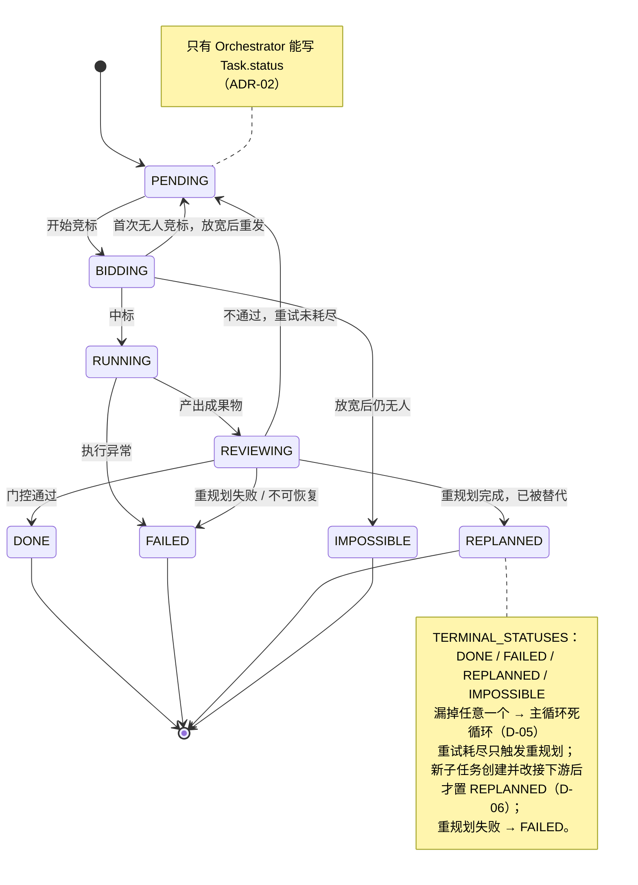
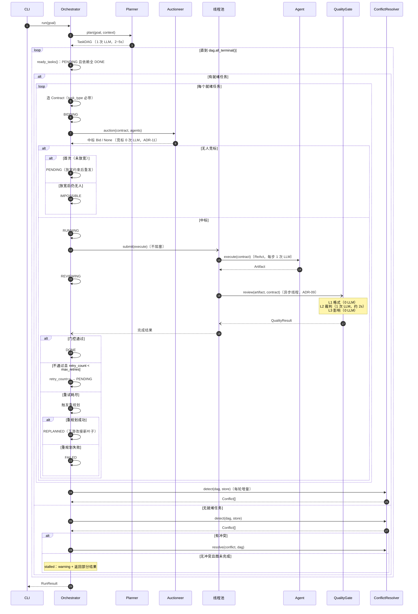

# ContractNet 详细设计文档

> 文档类型：**详细设计规格（Detailed Design Specification）**
> 定位说明：《项目计划书》界定项目目标、范围与排期；本文档界定系统结构、接口规格与异常处理规则，作为编码阶段的直接依据。
> 状态：v1.0（W0 基线版）｜ 2026-11-16
> 维护者：项目负责人（架构 owner）
> 变更规则：第 3 章（领域模型）与第 6 章（接口规格）在 **W2 冻结**后，改动需全员同意。

---

## 目录

| 章   | 内容          | 读者        |
| --- | ----------- | --------- |
| 1   | 系统定位与边界     | 全员        |
| 2   | 总体架构        | 全员        |
| 3   | 领域模型        | 全员（必读）    |
| 4   | 核心流程        | 全员（必读）    |
| 5   | 模块详细设计      | 各模块 owner |
| 6   | 接口规格汇总      | 全员        |
| 7   | 架构决策记录（ADR） | 全员        |
| 8   | 数据与存储       | R7        |
| 9   | 可观测性        | R8        |
| 10  | 错误处理与降级     | 全员        |
| 11  | 配置设计        | R5        |
| 12  | 非功能需求       | 全员        |
| 13  | 评估方案        | R8        |
| 14  | 里程碑与演进      | 全员        |
| 15  | 风险登记册       | 负责人       |
| 16  | 附录          | —         |

---

# 1. 系统定位与边界

## 1.1 系统定位

> 用户给一句自然语言目标，系统**自己决定**把活拆成几块、每块派给谁、干完怎么验收、撞车了怎么处理 —— 不靠人工预先画好协作图。

## 1.2 解决什么问题

现有多 Agent 框架（CrewAI / AutoGen / LangGraph）的三个结构性缺陷：

| 痛点         | 表现                            | 我们的对策                |
| ---------- | ----------------------------- | -------------------- |
| **静态角色绑定** | Agent 角色在启动时写死，无法按子任务特征动态分配   | 契约广播 + Agent 自主竞标    |
| **协作语义缺失** | Agent 间自由文本通信，无契约约束，无法检测冗余/冲突 | 结构化契约（输入/输出/约束全部可校验） |
| **质量不可控**  | 无过程门控，单个错误级联放大                | 三层质量门控 + 运行时重规划      |

## 1.3 明确的非目标（**本阶段不做**）

写清"不做什么"比写清"做什么"更重要，能防止范围无限膨胀：

| 非目标                 | 原因               |
| ------------------- | ---------------- |
| ❌ 通用 Agent 框架 / SDK | 我们是研究型 Demo，不是产品 |
| ❌ 支持任意 LLM 供应商的全部特性 | 只保证 OpenAI 兼容接口  |
| ❌ 多租户、权限体系、计费       | 无此需求             |
| ❌ 分布式部署（多机）         | 单机多进程/协程足够       |
| ❌ 生产级沙箱（防恶意代码）      | 沙箱只做误操作防护        |
| ❌ 可视化编排器（拖拽建图）      | 与本项目理念相反         |
| ❌ 向量检索 / RAG        | 与本项目无关           |
| ❌ 微调 / 训练           | 只用现成模型           |

## 1.4 目标场景

| 场景               | 输入                           | 系统应完成                                   |
| ---------------- | ---------------------------- | --------------------------------------- |
| **S1 全栈 API 生成** | 「实现带 JWT 认证的 Todo API，含测试和文档 | 拆成设计/实现/测试/文档，Coder 与 Tester 并行，冲突时串行化  |
| **S2 数据分析报告**    | 「分析这份销售数据，找出下降原因并给建议」        | 拆分清洗/统计/可视化/报告；发现数据缺失时**动态插入**补全子任务     |
| **S3 Bug 修复流水线** | 「修复这个 GitHub Issue」          | 复现/定位/修复/回归；两个 Agent 对根因判断不同时**并行对比取优** |

> **验收基准 = 这三个场景**。第 13 章的评估就基于它们。

## 1.5 术语表

| 术语                | 含义                        | 易混淆点                                       |
| ----------------- | ------------------------- | ------------------------------------------ |
| **Task（任务）**      | 一个可执行的工作单元                | 与 Contract 不同：Task 是「要什么」，Contract 是「怎么验收」 |
| **Contract（契约）**  | Task 的协议化表达：输入、输出规格、约束、截止 | 一个 Task 失败重试会生成**新 Contract**              |
| **Bid（出价）**       | Agent 对某个 Contract 的竞标声明  | 不含 LLM 调用结果，纯规则+历史统计                       |
| **Award（授标）**     | 从多个 Bid 中选出中标者            | 与「指派」不同：指派不经竞标                             |
| **Artifact（成果物）** | Agent 的产出，带内容与来源信息        | 不是"文件"，可能是一段文本/一个结构化对象                     |
| **DAG**           | 有向无环图，表达任务依赖              | 环检测是必须的，有环=设计错误                            |
| **Gate（门控）**      | 成果物入库前的校验                 | 不修改成果物，只判定通过/退回                            |
| **Replan（重规划）**   | 任务失败后重新分解                 | 与 Retry（重试）不同：重试是原地再来，重规划是拆细/换策略           |
| **provenance**    | 成果物的来源追踪（谁产出、谁消费）         | 没有它做不了级联冲突检测和回滚                            |
| **span**          | 一次操作的记录（开始/结束/属性）         | 串起来形成 trace                                |

---

# 2. 总体架构

## 2.1 分层架构

```
┌──────────────────────────────────────────────────────────┐
│ 接口层                                                    │
│   CLI（command-line）        Dashboard（Streamlit，W7）    │
└───────────────────────────┬──────────────────────────────┘
┌───────────────────────────▼──────────────────────────────┐
│ 编排层（Orchestrator）                                     │
│   主循环 │ 状态机 │ 并发控制 │ 重试/重规划决策                 │
└──┬──────────┬──────────┬──────────┬──────────┬───────────┘
   │          │          │          │          │
┌──▼───┐ ┌───▼────┐ ┌───▼────┐ ┌───▼────┐ ┌──▼─────────┐
│Plan  │ │Auction │ │ Agent  │ │ Gate   │ │ Conflict   │
│分解  │ │竞标    │ │执行    │ │三层校验 │ │冲突检测    │
└──┬───┘ └───┬────┘ └───┬────┘ └───┬────┘ └──┬─────────┘
   │         │          │          │         │
┌──▼─────────▼──────────▼──────────▼─────────▼───────────┐
│ 能力层                                                    │
│   LLMGateway（重试/缓存/预算/归因）  ToolSandbox（权限/超时）  │
└───────────────────────────┬──────────────────────────────┘
┌───────────────────────────▼──────────────────────────────┐
│ 基础层                                                    │
│   StateStore（状态/成果物）  Tracer（日志/trace）            │
└──────────────────────────────────────────────────────────┘
```

## 2.2 模块清单与职责矩阵

| 模块                   | 文件                        | 负责                 | **明确不负责**  |
| -------------------- | ------------------------- | ------------------ | ---------- |
| **Types**            | `core/types.py`           | 全部数据结构定义           | 任何业务逻辑     |
| **Planner**          | `core/planner.py`         | 目标→子任务 DAG；失败后重新分解 | 分配、执行、校验   |
| **Auctioneer**       | `core/auctioneer.py`      | 广播、收 Bid、评分、授标     | 分解、执行、失败处理 |
| **Agent**            | `core/agent.py`           | 竞标、执行（ReAct）、上报    | 决定谁中标、校验质量 |
| **Orchestrator**     | `core/orchestrator.py`    | 主循环、状态机、并发、决策      | 各模块内部细节    |
| **QualityGate**      | `core/quality_gate.py`    | 三层校验、结构化反馈         | 修改成果物、决定重试 |
| **ConflictResolver** | `core/conflict.py`        | 冲突检测、消解策略          | 判断单个成果物质量  |
| **LLMGateway**       | `llm/gateway.py`          | 统一模型调用、重试、缓存、预算    | 业务判断       |
| **ToolSandbox**      | `tools/sandbox.py`        | 工具执行、权限、超时、截断      | 决定调哪个工具    |
| **BuiltinTools**     | `tools/builtins.py`       | 内置工具实现（`file_read` / `file_write` / `list_dir` / `code_run` / `test_run`） | 权限校验与超时（由 ToolSandbox 统一处理） |
| **StateStore**       | `memory/store.py`         | 状态与成果物存取、回放        | 校验、判断、决策   |
| **Tracer**           | `observability/tracer.py` | 日志、span、指标采集       | 修改流程       |
| **AgentMemory**      | `memory/agent_memory.py`  | 执行日志、能力画像、失败模式、成功模板 | 全局状态管理     |
| **EventBus**         | `core/event_bus.py`       | 事件发布订阅（协议 + 内存实现）    | 业务判断       |
| **EvalFramework**    | `eval/`                   | 基准任务、指标计算、实验运行、报告    | 修改系统行为     |

## 2.3 依赖关系

```
Types ← 所有模块（被依赖最多，所以改动代价最高）
Tracer ← 所有模块（横切）
StateStore ← Orchestrator / Gate / Conflict
LLMGateway ← Planner / Gate / Agent
ToolSandbox ← Agent
其他：Orchestrator → 全部（中枢）
```

**禁止的依赖方向**（违反会导致循环依赖）：

| 禁止 | 原因 |
|---|---|
| Planner → Orchestrator | Planner 不该知道谁在调度它 |
| Gate → Orchestrator | Gate 只判定，不决策 |
| Agent → 另一个 Agent | 铁律：禁止 Agent 间直接通信 |
| Types → 任何模块 | Types 必须是最底层，零依赖 |

## 2.4 运行形态

**单进程**。理由：
- 8 人 × 10 周，无跨机需求
- 单进程便于调试与断点
- 并发靠**线程池**（W2 定稿，见 ADR-01）

```
进程
├── 主线程：Orchestrator 主循环
├── 线程池（max_workers=4）：Agent 执行
└── 后台线程：Tracer 落盘（可选，W7）
```

## 2.5 并发模型

| 项 | 决策 |
|---|---|
| 并发单元 | Agent 执行（每个 Task 一个线程任务） |
| 上限 | `max_concurrent`（默认 4，可配置） |
| Agent 级互斥 | 同一 Agent 同时只能跑一个 Task（`is_busy` 标记） |
| Gate 校验 | **必须异步**，不能占用主循环（见 ADR-09） |
| 超时 | 每个 Task 有 wall-clock 超时（默认 180s） |

---

# 3. 领域模型

> **W2 冻结。** 冻结后修改需要全员同意。
>
> **本章由 `tests/test_domain_model.py` 守护**：本章写出的每个字段，代码里必须存在；代码里有的字段，本章必须写出。
> 改本章和改 `types.py` 必须在同一个 PR 里，否则测试会红。

## 3.1 模型关系总览

```
Goal(字符串)
  └─ TaskDAG
       └─ Task[]（含 depends_on 指向其他 Task）
             │
             └─1:N Contract（每次重试生成新契约）
                    ├─ Bid[]（N 个 Agent 出价）
                    └─ Artifact（中标者产出）
                          └─ QualityResult（门控结论）
                               └─ Conflict[]（与已有成果物的冲突）
```

## 3.2 Task

| 字段 | 类型 | 必填 | 说明 |
|---|---|---|---|
| `task_id` | `str` | 是 | 自动生成 `task_<12hex>` |
| `description` | `str` | 是 | 自然语言任务描述 |
| `task_type` | `str` | 是 | `code`/`test`/`doc`/`analysis`/`design`/`review` |
| `depends_on` | `list[str]` | 否 | 依赖的 task_id 列表 |
| `input_artifacts` | `list[str]` | 否 | 需要的成果物 ID |
| `output_artifact_id` | `str \| None` | 否 | 产出的成果物 ID |
| `status` | `TaskStatus` | 是 | 见 3.3 |
| `retry_count` | `int` | 是 | 已重试次数，默认 0 |
| `max_retries` | `int` | 是 | 默认 3 |
| `depth` | `int` | 否 | DAG 层级（用于调试与粒度控制） |
| `created_at` | `float` | 是 | 时间戳 |

## 3.3 TaskStatus 与状态机

```python
class TaskStatus(str, Enum):
    PENDING     = 'pending'      # 等待竞标
    BIDDING     = 'bidding'      # 竞标中
    RUNNING     = 'running'      # 执行中
    REVIEWING   = 'reviewing'    # 质量门控中
    DONE        = 'done'         # 完成
    FAILED      = 'failed'       # 失败（重试耗尽或不可恢复）
    REPLANNED   = 'replanned'    # 已被子任务替代
    IMPOSSIBLE  = 'impossible'   # 无人能接
```

### 终止态集合（**必须显式定义**）

```python
TERMINAL_STATUSES = frozenset({DONE, FAILED, REPLANNED, IMPOSSIBLE})
```

> ⚠️ **设计陷阱 D-05**：如果把 `REPLANNED` 排除在终止态之外，
> 有任务被重规划时主循环的退出条件永远不满足 → **死循环**。

### 合法转移表

| 当前 | 允许转到 | 触发者 |
|---|---|---|
| PENDING | BIDDING | Orchestrator |
| BIDDING | RUNNING, PENDING（首次无人竞标，放宽后重发）, IMPOSSIBLE（放宽后仍无人） | Orchestrator |
| RUNNING | REVIEWING, FAILED | Orchestrator |
| REVIEWING | DONE, PENDING（重试）, REPLANNED（重规划完成，已被子任务替代）, FAILED（重规划失败 / 不可恢复） | Orchestrator |
| DONE / FAILED / REPLANNED / IMPOSSIBLE | **（终态，不可转出）** | — |

**违反此表的转移视为 bug**，测试中应有断言。

### 状态转移图



> 该图与上表逐条对应；终态由 `TERMINAL_STATUSES` 判定，漏掉任意一个主循环都无法退出（D-05）。

## 3.4 TaskDAG

```python
class TaskDAG(BaseModel):
    goal: str
    tasks: dict[str, Task]
```

**三个核心方法**（调度器的全部逻辑都依赖它们）：

```python
def ready_tasks(self) -> list[Task]:
    """自己是 PENDING，且所有依赖都恰好是 DONE。"""

def all_terminal(self) -> bool:
    """所有任务都在 TERMINAL_STATUSES 中。
    ⚠️ 不要用"所有任务 DONE"作退出条件 —— 有失败任务时会死循环。"""

def update_status(self, task_id, status) -> None:
    """只有 Orchestrator 调用。"""
```

> ⚠️ **设计陷阱 D-06**：`ready_tasks` 的判断是「依赖**恰好等于** DONE」。
> 这意味着一件事：**重规划之后，必须把下游任务的 `depends_on` 从旧任务改接到新子任务的叶子节点上**，
> 否则旧任务永远停在 `REPLANNED`，下游永远等不到 `DONE` → **整条下游链静默卡死**。

## 3.5 Contract

| 字段 | 类型 | 说明 |
|---|---|---|
| `contract_id` | `str` | `ctr_<12hex>` |
| `task_id` | `str` | 关联的任务 |
| **`task_type`** | `str` | ⚠️ **必须有**（见 ADR-03） |
| `description` | `str` | 继承自 Task |
| `input_artifacts` | `list[str]` | 输入成果物 ID |
| `output_spec` | `OutputSpec` | 见 3.6 |
| `constraints` | `ContractConstraints` | 见下 |
| `deadline_steps` | `int` | 最大执行步数 |
| `created_at` | `float` | — |

**`ContractConstraints`（执行约束）**

```python
class ContractConstraints(BaseModel):
    max_tokens: int = 5000
    max_steps: int = 10
    required_tools: list[str] = []
    forbidden_tools: list[str] = []
    quality_threshold: float = 0.8     # 及格线，不是分数！
```

### 按任务类型的默认约束

| task_type | max_tokens | max_steps | required_tools | threshold |
|---|---|---|---|---|
| code | 5000 | 10 | file_write, code_run | 0.80 |
| test | 3000 | 8 | file_read, code_run | 0.85 |
| doc | 2000 | 5 | file_read, file_write | 0.75 |
| analysis | 4000 | 10 | data_read, code_run | 0.80 |
| design | 3000 | 6 | file_write | 0.80 |
| review | 2000 | 5 | file_read | 0.80 |

## 3.6 OutputSpec（**关键设计**）

> 设计约束：代码类产物不是 JSON，不能直接使用 `json.loads` 校验。

```python
class OutputSpec(BaseModel):
    kind: Literal['json', 'python', 'text', 'binary']
    json_schema: dict | None = None   # kind == 'json' 时使用
    must_contain: list[str] = []      # 代码/文档必须包含的符号或标题
    min_length: int = 0
    optional_syntax_check: bool = True  # python: 用 ast.parse 验证
```

> **W2 改名说明**：该字段原名 `schema`，与 Pydantic 内置的 `BaseModel.schema()` 重名会被遮蔽
> （实例属性访问虽能用，但 `spec.schema()` 调用会拿到字段值而不是方法，是个隐蔽陷阱），
> 冻结时改为 `json_schema`。

### L1 校验方式按类型分派

| kind | L1 校验手段 | 失败示例 |
|---|---|---|
| `json` | `jsonschema.validate` | 字段缺失、类型错 |
| `python` | `ast.parse()` 通过 + 出现 `must_contain` 中的函数/类名 | 语法错误 |
| `text` | 非空 + 长度 ≥ `min_length` + 含 `must_contain` | 空产出 |
| `binary` | 文件存在 + 大小 > 阈值 | 写盘失败 |

> ⚠️ **设计陷阱 D-04**：如果只实现 `json.loads` 分支，
> 代码/文档产物的 L1 会全部走"跳过"或"异常"，等于**门控第一层形同虚设**。

## 3.7 Bid

| 字段 | 类型 | 说明 |
|---|---|---|
| `bid_id` | `str` | `bid_<12hex>` |
| `contract_id` | `str` | 竞标的契约 |
| `agent_id` | `str` | 出价方 |
| `capability` | `float` | 能力匹配度 [0,1]，**纯规则计算** |
| `estimated_cost` | `int` | 预估 token，用历史均值 |
| `confidence` | `float` | [0,1]，**用历史成功率，不用 LLM 自报**（ADR-07） |
| `plan` | `str` | 执行思路简述（可空，省成本） |

## 3.8 Artifact

| 字段 | 类型 | 说明 |
|---|---|---|
| `artifact_id` | `str` | `art_<12hex>` |
| `task_id` | `str` | 产出它的任务 |
| `content` | `str` | 内容本体 |
| `artifact_type` | `str` | `text`/`code`/`data`/`report` |
| `file_path` | `str \| None` | 若落盘，相对 workspace 的路径 |
| `quality` | `float \| None` | ⚠️ **未评分必须是 `None`**（ADR-04） |
| `created_at` | `float` | 时间戳 |
| `provenance` | `Provenance \| None` | 见下（ADR-08）。**未归档时为 `None`**，归档时由 Orchestrator 填 |

**`Provenance`（来源链）**

```python
class Provenance(BaseModel):
    produced_by: str            # contract_id
    agent_id: str
    consumed_by: list[str] = [] # 消费了它的 contract_id 列表
    parent_artifact_ids: list[str] = []   # 衍生自哪些成果物
    version: int = 1
```

> **为什么 provenance 是一等公民**：没有它，冲突检测只能做"文件路径相同"这种表层判断，
> 做不了"级联影响"和"回滚"。

## 3.9 QualityResult

```python
class QualityResult(BaseModel):
    passed: bool
    score: float | None = None       # ⚠️ 未实际评分时必须是 None
    feedback: str = ''               # 结构化反馈，会喂回给重试
    layer: str = ''                  # 'schema' | 'semantic' | 'impact' | 'none'
    details: list[LayerResult] = []  # 每层结果（含短路信息）
```

**`LayerResult`（每层一条）**

| 字段 | 类型 | 说明 |
|---|---|---|
| `layer` | `str` | `schema` / `semantic` / `impact` / `none` |
| `passed` | `bool` | 该层是否通过 |
| `score` | `float \| None` | ⚠️ 未实际评分时必须是 `None`（ADR-04） |
| `message` | `str` | 失败原因 / 短路说明 |

> 三层校验 W5 才实现，届时若各层字段差异变大（语义层要裁判理由、影响层要级联清单），
> 按需扩展 `LayerResult`；W2 冻结只保证「过了没有 / 为什么」这两件事能记下来。

## 3.10 Conflict / Resolution

```python
class ConflictType(str, Enum):
    FILE_WRITE          = 'file_write'           # 两个任务写了同一文件
    INTERFACE_MISMATCH  = 'interface_mismatch'   # 函数签名对不上
    SEMANTIC_CONTRADICTION = 'semantic_contradiction'  # 结论互相否斥
    DEPENDENCY_VIOLATION = 'dependency_violation' # 读到了未完成的产出
    DEADLOCK            = 'deadlock'             # 循环等待
```

**Conflict 实体**（定义在 `core/types.py`）

| 字段 | 类型 | 说明 |
|---|---|---|
| `conflict_id` | `str` | `conf_<12hex>` |
| `conflict_type` | `str` | 取 `ConflictType` 的 value。W6 收窄为枚举类型 |
| `description` | `str` | 供消解与日志使用 |

`Resolution`（消解结论）在 W6 随消解策略一并定稿。

> **W2 明确**：`Resolution` **本次不冻结**。它依赖五种消解策略（串行化 / 定义方先行 / 并行对比取优 / 回滚等待 / 强制终止），
> 策略没实现之前定形状只能靠猜。`conflict.py` 里原写「TODO(W2)」已改为 **TODO(W6)**，与本节一致。

> 设计约束：`interface_mismatch` 与 `semantic_contradiction` 两类冲突实现成本较高，
> 常见做法是只实现消解分支而省略检测分支，导致这两类冲突实际无法被发现。本项目要求五类检测全部落地（见 §5.6）。
> 我们要求 5 种检测全部落地（见 5.6）。

## 3.11 Event（用于日志与回放）

```python
class EventType(str, Enum):
    TASK_CREATED        = 'task_created'
    BID_RECEIVED        = 'bid_received'
    TASK_AWARDED        = 'task_awarded'
    AGENT_STARTED       = 'agent_started'
    ARTIFACT_PRODUCED   = 'artifact_produced'
    GATE_PASSED         = 'gate_passed'
    GATE_FAILED         = 'gate_failed'
    RETRY_SCHEDULED     = 'retry_scheduled'
    REPLAN_TRIGGERED    = 'replan_triggered'
    CONFLICT_DETECTED   = 'conflict_detected'
    CONFLICT_RESOLVED   = 'conflict_resolved'


class Event(BaseModel):
    event_id: str            # evt_<12hex>
    trace_id: str
    ts: float
    task_id: str | None      # run 级事件（如整体完成）可为 None
    event_type: EventType
    payload: dict
```

> **W2 冻结时的取舍**：11 种事件**不拆成 11 个子类**，用 `event_type` 区分。
> 理由：回放要反序列化，单一模型 + `payload` 比拼 11 个分支简单可靠；各类型的 `payload` 结构在 W7 落库时再逐类细化。
> `StateStore.log_event(e: Event)` / `events()` 因此有了确定类型（原先是 `dict`）。

## 3.12 CapabilityProfile（Agent 能力声明）

```python
class CapabilityProfile(BaseModel):
    agent_id: str
    task_types: list[str] = []    # 能接的任务类型，'*' 表示通配
    tools: list[str] = []         # 允许使用的工具名
    base_confidence: float = 0.5  # 冷启动置信度；有历史后按成功率修正（ADR-07）
```

| 字段 | 说明 |
|---|---|
| `task_types` | 竞标时用于能力匹配；`'*'` 是兜底 Agent，其 `capability` 应略低于精确匹配，否则它总赢 |
| `tools` | 工具权限的**唯一来源**：`BaseAgent` 按它过滤工具后再传给模型（见 §5.7） |
| `base_confidence` | 冷启动值。有历史数据后改用历史成功率 + 先验（ADR-07），不用 LLM 自报 |

> W3 由 R1 与 R5 一起细化（`tools` 是否需要带参数/权限级别）。当前形状对齐 `BaseAgent` 现有构造参数，保证接口不缺。

---

# 4. 核心流程

## 4.1 一次执行的完整时序

```
T+0      CLI 接收目标
T+50     Planner 分解（LLM 1 次调用，2~5s）
T+3s     DAG 就绪 → 取 ready_tasks
T+3s     对每个 ready task：造 Contract → 广播 → 收 Bid → 仲裁
         首次无人竞标 → 放宽约束后重发；仍无人 → IMPOSSIBLE
T+3s     授标 → 提交 Executor（线程池）
T+3s~    Agent 执行（ReAct 循环，每步 1 次 LLM 调用）
T+...    成果物 → QualityGate（L1 本地 / L2 LLM 裁判 2s / L3 比对）
         通过 → 归档，Task=DONE
         不通过 → retry_count++ ；< max 则回 PENDING；否则触发重规划（完成后置 REPLANNED；失败置 FAILED）
T+...    每轮结束：冲突检测（增量）
T+...    全部终态 → 合并结果 → 输出
```

> ⚠️ **时间直觉**：一次真实执行是 **分钟级**（不是秒级）。
> 所以任何"在主循环里同步调用 LLM"的写法都会让系统卡死（ADR-09）。

### 时序图



> Gate 用异步箭头标出（ADR-09）；主循环只负责派发与收结果，全程不同步调用 LLM。

## 4.2 主循环伪代码

```python
def run(goal):
    dag = planner.plan(goal)                  # 1 次 LLM
    relaxed: set[str] = set()                 # 无人竞标只放宽重发一次；不写 Task 字段

    while not dag.all_terminal():             # ← 用 all_terminal，不是 all_done
        ready = dag.ready_tasks()
        if not ready:
            conflicts = resolver.detect(dag, store)
            for c in conflicts:
                resolver.resolve(c, dag)
            if not conflicts:
                log.warning('无就绪任务但图未完成 → stalled')
                break                          # 必须有的出口
            continue

        # 派发：不阻塞
        inflight = []
        for task in ready:
            # relaxed 时放宽 max_steps / max_tokens，不动 quality_threshold
            contract = contracts.create(task, relaxed=task.id in relaxed)
            dag.update_status(task.id, BIDDING)
            winner = auctioneer.auction(contract, agents, busy_set)
            if winner is None:
                if task.id in relaxed:
                    dag.update_status(task.id, IMPOSSIBLE)
                else:
                    relaxed.add(task.id)
                    dag.update_status(task.id, PENDING)  # 下一轮放宽约束重发
                continue
            relaxed.discard(task.id)              # 中标后清掉放宽标记，后续重试重新计算
            dag.update_status(task.id, RUNNING)
            inflight.append(executor.submit(agent_execute, contract, winner))

        # 收集：随便谁完成都处理（异步，不在主循环里调 LLM）
        for done in executor.drain_completed():
            gate_result = done.gate_result        # Gate 已在线程里跑完
            handle_result(done.task, gate_result, dag)
```

## 4.3 就绪判定

```
ready(task) ⟺ task.status == PENDING
             ∧ ∀ dep ∈ task.depends_on: dag[dep].status == DONE
```

**注意**：依赖缺失（`dep not in dag.tasks`）视为**满足**还是**不满足**？
本项目规定：**视为不满足并记 warning**（早暴露错误比静默通过好）。

## 4.4 终止条件与卡死检测

| 条件 | 处理 |
|---|---|
| 全部任务进入终止态 | 正常结束，按 `done/total` 算完成率 |
| 无就绪任务 + 图未完成 + 无冲突 | **stalled**：记 error 日志，返回部分结果（`success=False`） |
| 无就绪任务 + 有冲突 | 消解冲突后继续 |
| 超过全局步数上限（默认 200 轮） | 强制结束，标记 `aborted` |

> **必须实现 stalled 出口**。没有它，程序会"看起来正常结束"但只完成了 1/4 —— 这是最难发现的一类 bug。

## 4.5 并发控制

| 规则                    | 说明                                   |
| --------------------- | ------------------------------------ |
| 最大并发                  | `max_concurrent`（默认 4）               |
| Agent 互斥              | 同一 Agent 不能并行执行两个 Task               |
| **忙碌 Agent 在竞标阶段就过滤** | 不要在提交后才排队（见 ADR-10）                  |
| 超时                    | 每 Task wall-clock 超时（默认 180s），超时视为失败 |
| 取消                    | 支持全局 cancel，向所有在跑任务发取消信号             |

## 4.6 异常分类与处理矩阵（**必读**）

| 异常类型       | 举例                                  | 处理                     | 是否消耗 retry |
| ---------- | ----------------------------------- | ---------------------- | ---------- |
| **瞬态外部错误** | 网络超时、429 限流、503                     | 指数退避重试（在 LLMGateway 内） | 否          |
| **配置错误**   | 401 无权限、404 模型不存在                   | **立即失败**，不重试，报错退出      | 否          |
| **产出不合格**  | Schema 不通过、语义不达标                    | 重试（带结构化反馈）             | **是**      |
| **执行超时**   | Agent 超过 deadline_steps / wall time | 重试（放宽约束）或重规划           | **是**      |
| **无人竞标** | 无 Agent 匹配 | 首次放宽约束后重发一轮；仍无人 → IMPOSSIBLE | 否 |
| **依赖永不满足** | 上游 REPLANNED 但未改接                   | 视为 stalled             | —          |
| **代码 bug** | `KeyError`、`AttributeError`         | **不吞**，向上抛，记 error     | 否          |

> ⚠️ **禁止**：`except Exception: pass`。任何异常被吞掉，后续只会看到"结果不对但不知道为什么"。

---

# 5. 模块详细设计

> 每个模块统一按 6 段写：职责边界 / 接口 / 核心算法 / 失效模式 / 并发与异常 / 测试点。

## 5.1 Planner（任务分解器）— owner: R2

### 职责边界

| 负责 | 不负责 |
|---|---|
| 目标 → 子任务 DAG | 分配任务 |
| 为每个子任务生成 Contract 草案（含 task_type 与约束） | 决定用什么模型 |
| 失败后的重新分解（拆细 / 合并 / 放宽） | 执行、校验 |

### 接口

```python
class Planner:
    def __init__(self, llm: LLMGateway | None = None): ...

    def plan(self, goal: str, context: PlanContext | None = None) -> TaskDAG: ...
    def replan(self, failed_task: Task, reason: str) -> tuple[TaskDAG, list[str]]: ...
```

### 核心算法

**① 分解（LLM 主路径 + 规则兜底）**

```
输入：goal, ctx{已有文件, 可用 Agent 类型, 历史任务}
prompt 要求：
  - 输出 JSON 数组，每项 {description, task_type, dependencies:[idx]}
  - 子任务数 3~8
  - 每个子任务 5~15 步可完成
  - 依赖只能引用更早的索引（防环）
后处理（必须执行）：
  1. 解析失败 → 兜底：4 段模板（design→code→test→doc）
  2. 依赖索引越界 / 自依赖 → 过滤掉
  3. 子任务数 < 3 → 补模板；> 8 → 截断
  4. 环检测（DFS）
  5. 计算 depth
  6. 给每个子任务推定 task_type 与约束
```

**② 重规划决策树**

| 失败原因（来自 Gate 的 feedback） | 策略 | 动作 |
|---|---|---|
| `schema` 不通过 | 换更强模型 | 新 Contract 带 `preferred_model` |
| `semantic` 不通过 | 细化分解 | 拆成 2 个子任务 |
| 超时 | 放宽资源 | `max_steps × 1.5`、`deadline × 1.5`；**不动 quality_threshold** |
| 冲突 | 串行化 | 给两个任务加重叠依赖 |
| 其他 | 原样重试 | — |

**③ 重规划后必须改接下游依赖**

```python
def replan(self, failed, reason):
    new_dag = self._build(...)
    # 关键步骤：找出新子任务中不再被其他子任务依赖的末端节点
    leaves = [t for t in new_dag.tasks if t not in depended]
    return new_dag, leaves        # 交给 Orchestrator 改接
```

**④ 四种分解策略**

| 策略 | 触发条件 | 行为 | 阶段 |
|---|---|---|---|
| **初次分解** | 用户提交目标 | 全量分解为子任务 DAG | W3 |
| **细化分解** | 子任务 `retry_count ≥ max_retries` 且语义不达标 | 拆成 2 个更细子任务，继承父任务的 `input_artifacts` | W5 |
| **合并分解（升级）** | 相邻子任务频繁互相等待，协调开销大于执行开销 | 合并为单个较大子任务，交由单个 Agent 完成 | W7 |
| **增量分解** | 执行中发现新需求（如数据缺失需补全） | 在当前 DAG 中插入新子任务，并改接下游依赖 | W7 |

> **合并策略的判定条件**：子任务 `depth` 接近上限，或同一父任务下的子任务之间出现互相等待且总步数低于阈值。
> 合并时须继承被合并任务的全部 `input_artifacts`，并汇总它们的 `depends_on` 作为合并后任务的依赖。

> **增量策略与重规划的差别**：重规划由**失败**触发；增量分解由**执行中发现的新信息**触发，与失败与否无关。

### 失效模式分析

| 现象 | 根因 | 对策 |
|---|---|---|
| 分解出 1 个巨大任务 | prompt 未约束粒度 | 加"3~8 个"硬约束 + 后处理补齐 |
| DAG 有环 | LLM 生成了回指依赖 | 后处理 DFS 环检测，发现即丢弃边 |
| 下游任务全部卡死 | 重规划后未改接依赖 | 见 4.4 / ADR-06 |
| 分解质量随温度波动 | 未固定随机性 | 分解用 `temperature=0` |
| 失败重规划变成无限拆细 | 没有深度上限 | 加 `depth < 3` 限制，超限标 FAILED |

### 测试点

- [ ] 给一句目标，输出 DAG 无环、任务数 3~8
- [ ] LLM 返回非法 JSON 时走兜底且不崩
- [ ] LLM 返回回指依赖时被过滤
- [ ] `replan` 后返回的叶子集合非空
- [ ] 深度超过 3 时不再拆细

---

## 5.2 Auctioneer（竞标仲裁器）— owner: R3

### 职责边界

| 负责 | 不负责 |
|---|---|
| 广播契约给可用 Agent | Agent 是否出价 |
| 收集、校验 Bid | 执行 |
| 综合评分并授标 | 失败处理 |
| 无竞标时的诊断与放宽建议（重发由 Orchestrator 执行） | — |

> 无竞标时 Auctioneer 只返回 `None` 并给出原因/放宽建议；Contract 的放宽与重新广播由 Orchestrator 执行（Task 状态只能由 Orchestrator 写，ADR-02）。

### 接口

```python
class Auctioneer:
    def auction(self, contract: Contract, agents: list[BaseAgent]) -> Bid | None: ...
    def score(self, bid: Bid, contract: Contract) -> float: ...
    def history(self, contract_id: str) -> list[Bid]: ...
```

### 核心算法

**两阶段筛选（ADR-11，省 token 的关键）**

```
阶段 1（零成本，纯规则）：
    a. task_type 是否在 agent.task_types（或 '*'）
    b. required_tools 是否被 agent.tools 覆盖
    c. agent 是否 busy
    → 不通过直接返回 None，**不调 LLM**
阶段 2（仅对通过者）：
    capability = 0.6 × 类型匹配 + 0.4 × 工具覆盖
    confidence = 0.4 × 静态匹配 + 0.6 × 历史成功率（无历史用 0.5 先验）
    cost_eff   = 1 - min(1, log1p(cost) / log1p(budget))
    score = 0.5·capability + 0.2·cost_eff + 0.3·confidence
```

**为什么竞标阶段不调 LLM**：7 个 Agent × 5 个子任务 = 35 次调用。
按每次 2k token 算，一次目标光竞标就 7 万 token —— **会吃掉整个项目的预算**。

### 失效模式

| 现象 | 根因 | 对策 |
|---|---|---|
| 通配 Agent 总是赢 | `'*'` 判满分 | 通配的 capability 乘 0.85 折扣 |
| 新 Agent 永远不出价 | 无历史 → confidence 低 | 新 Agent 用先验 0.5，不惩罚 |
| 历史表现被重复加权 | capability 和 confidence 都含历史 | 二者**只允许一处**含历史 |
| 成本权重等于没有 | `1/(1+cost/1000)` 差异太小 | 用 `log1p` 归一化，且权重 ≥ 0.2 |
| 分给忙碌 Agent | 竞标阶段未过滤 busy | 阶段 1 过滤 |

### 测试点

- [ ] `task_type='code'` 的任务派给 Coder，不是 General
- [ ] 全部 Agent 不匹配 → 返回 None
- [ ] 忙碌 Agent 不参与竞标
- [ ] 无历史时 confidence 不为 0

---

## 5.3 Agent（执行单元）— owner: R4

### 职责边界

| 负责 | 不负责 |
|---|---|
| 评估是否竞标 | 决定谁中标 |
| 执行契约（ReAct 循环） | 校验自身产出 |
| 上报成果物与执行记录 | 与其他 Agent 通信（**禁止**） |

### 接口

```python
class BaseAgent(ABC):
    agent_id: str
    name: str
    task_types: list[str]
    tools: list[str]
    is_busy: bool

    def bid(self, contract: Contract) -> Bid | None: ...
    @abstractmethod
    def execute(self, contract: Contract) -> Artifact: ...
```

### 核心算法：ReAct 循环

```
messages = [system(角色+能力+工具+经验), user(任务+约束+输入成果物)]
steps = 0
while steps < deadline_steps:
    resp = llm.chat(messages, tools=可用工具)
    if not resp.tool_calls:          # 它给答案了
        break
    messages.append(assistant带tool_calls)
    for call in resp.tool_calls:     # 并行工具调用要全部处理
        result = sandbox.execute(call.name, call.args)
        messages.append(tool结果, tool_call_id=call.id)
    steps += 1
if steps >= deadline: 返回部分结果 + 标记 truncated
```

**三个必须做对的细节**：

1. **assistant 消息必须原样回填 `tool_calls`**，否则下一轮 API 报错
2. **每个 tool 结果必须带对应的 `tool_call_id`**
3. **工具报错要作为结果返回给模型**（不要抛异常），让它自己决定重试

### 失效模式

| 现象 | 根因 | 对策 |
|---|---|---|
| 第二轮 API 报错 | assistant 消息丢了 tool_calls | 原样回填 |
| 模型反复调同一个工具 | 工具返回错误但格式是"成功" | 错误必须显式标注 `Error:` |
| 无限循环 | 没有步数上限 | `while steps < deadline` |
| 产出为空 | 最后一步是工具调用而非回答 | 兜底：取最后一条 assistant content |
| 上下文爆掉 | 工具输出太长 | 沙箱截断（默认 10000 字符） |

### 测试点

- [ ] 多轮工具调用能正确回填
- [ ] 工具报错后模型能看到错误并调整
- [ ] 超过 `max_steps` 时正常退出
- [ ] 不调用 LLM 的路径（mock）能测

---

## 5.4 Orchestrator（调度中枢）— owner: R1

### 职责边界

见 2.2。**额外强调**：它是 Task 状态的**唯一写者**（ADR-02）。

### 接口

```python
class Orchestrator:
    def run(self, goal: str) -> RunResult: ...
    def cancel(self) -> None: ...
    def status(self) -> SystemStatus: ...
```

### 配套类型：SystemStatus

`status()` 的返回快照。字段对应 `Orchestrator.status()` docstring 承诺的三件事：
各状态任务计数（`task_counts`）、在跑任务（`inflight_task_ids`）、已用预算（`used_tokens`）。

与 `RunResult` 的区别：`RunResult` 是执行结束后的最终结果，`SystemStatus` 是运行中的实时快照。

| 字段名 | 类型 | 必填 | 默认值 | 用途 |
|---|---|---|---|---|
| `running` | `bool` | 是 | — | 主循环是否正在执行；唯一必填字段 |
| `goal` | `str \| None` | 否 | `None` | 当前执行目标；空闲时为 `None` |
| `trace_id` | `str \| None` | 否 | `None` | 当前 trace；空闲时为 `None` |
| `task_counts` | `dict[str, int]` | 否 | 8 个状态全为 0 | 各状态任务数；键为 `TaskStatus` 的值 |
| `inflight_task_ids` | `list[str]` | 否 | `[]` | `RUNNING` + `REVIEWING`，不含 `PENDING` / `BIDDING` |
| `busy_agent_ids` | `list[str]` | 否 | `[]` | 当前 `is_busy=True` 的 Agent id |
| `used_tokens` | `int \| None` | 否 | `None` | 已用 token 合计；`None` 表示网关未报告，不能当 0 |

**口径**：`inflight_task_ids` 含 `REVIEWING`（ADR-09 Gate 异步，排查卡死需具体 id）；`busy_agent_ids` 与它不是同一件事（Agent 在 `execute()` 返回后释放）；展示层判断未知须用 `is None`（JS 中 `=== null`）。

### 核心算法

见 4.2 伪代码。关键约束：

| 约束 | 原因 |
|---|---|
| 主循环里**不得同步调用 LLM** | 会把全系统卡住 |
| Gate 校验作为独立任务提交 | 同上 |
| 必须有 stalled 出口 | 否则死循环 |
| 状态只能通过 `update_status` 改 | 便于统一埋点与回放 |

### 失效模式

| 现象 | 根因 | 对策 |
|---|---|---|
| 死循环 | 用 `all_done` 做退出条件 | 用 `all_terminal` |
| 程序"正常结束"但只完成 1/4 | 无 stalled 日志 | 必须打 warning |
| 一个 Gate 卡住全系统 | Gate 同步执行 | Gate 异步 |
| 状态不一致 | 多模块写状态 | 单写者 |
| 忙碌 Agent 收到任务后返回空成果物 | 提交阶段才判 busy | 竞标阶段就过滤 |

### 测试点

- [ ] 有失败任务时能正常退出（不死循环）
- [ ] 无就绪任务时打 stalled 并返回部分结果
- [ ] 状态转移符合 3.3 的表
- [ ] 并发 4 个任务时不出竞态

---

## 5.5 QualityGate（三层门控）— owner: R6

### 职责边界

见 2.2。

### 接口

```python
class QualityGate:
    def __init__(self, judge: LLMGateway | None = None, store=None): ...
    def review(self, artifact: Artifact, contract: Contract) -> QualityResult: ...
```

### 核心算法：三层短路

```
L1 格式校验（成本≈0）
  按 output_spec.kind 分派（见 3.6）
  失败 → 立即返回，不开销 L2/L3
L2 语义校验（调 LLM 裁判）
  prompt 要求返回 {satisfied, score, reason, missing}
  解析：剥 markdown 围栏 → json.loads → 正则抠首个 {...} → 兜底
  未配置裁判 → score = None（**不是 threshold**），跳过并记 warning
L3 影响校验（O(n)）
  遍历已有成果物：文件路径冲突 / 接口签名冲突 / 语义矛盾（抽样）
```

### 关键约定

| 约定 | 原因 |
|---|---|
| **未评分时 `score=None`** | 用阈值冒充会让下游全部指标失真（ADR-04） |
| Judge 必须与执行模型**不同** | 防自评偏袒 |
| 裁判失败时**fail-closed**（判不通过并告警），不是 fail-open | 质量门控是防线，不能默认放行（ADR-12） |
| 反馈必须**结构化**（缺什么，不是"不好"） | 重试时要喂回给 Agent |

### 失效模式

| 现象 | 根因 | 对策 |
|---|---|---|
| 代码产物的 L1 全部跳过 | 只实现了 json 分支 | 按 kind 分派 |
| 所有分数都一样 | 无裁判时用阈值充数 | score=None |
| 裁判输出解析失败就放行 | fallback 默认 passed | 改为 fail-closed |
| 门控拖慢全系统 | 同步执行 | 异步 |
| 裁判成本过高 | 每条都评 | 只评未通过 L1 的；语义级可抽样 |

### 测试点

- [ ] 代码产物（.py）能通过 L1（ast 解析）
- [ ] 语法错误的代码产物 L1 失败
- [ ] 无裁判时 `score is None`
- [ ] 裁判返回乱格式时不崩且判定可预期
- [ ] 短路：L1 失败时不调用裁判

---

## 5.6 ConflictResolver（冲突消解）— owner: R7

### 职责边界

见 2.2。**本项目最核心的差异化模块**。

### 五种检测（全部要落地）

| 类型 | 检测手段 | 实现难度 |
|---|---|---|
| **文件写冲突** | 两个 Artifact 的 `file_path` 相同且 `task_id` 不同 | 低（先做） |
| **依赖违规** | 某个 Artifact 的输入来源状态非 DONE | 低 |
| **死锁** | wait-for graph 上 DFS 找环 | 中 |
| **接口不一致** | `ast` 解析两个 .py 产物的函数签名，比对 | 中高 |
| **语义矛盾** | LLM 裁判对比两条结论（抽样 20%） | 高（可抽样） |

### 五种消解策略

| 冲突 | 策略 | 说明 |
|---|---|---|
| 文件写冲突 | **串行化** | 加依赖，让后者基于前者产出 |
| 接口不一致 | **定义方先行** | 接口定义任务先完成，调用方重新执行 |
| 语义矛盾 | **并行对比取优** | 两产出一并送 Gate 评分，取高分 |
| 依赖违规 | **回滚等待** | 撤销违规产出，等依赖完成 |
| 死锁 | **强制终止** | 终止环中 retry_count 最高者 |

### 失效模式

| 现象 | 根因 | 对策 |
|---|---|---|
| 检测不到接口冲突 | 只比字符串不管 AST | 用 `ast` 提取签名 |
| 串行化后任务不跑 | 只在运行时改状态，没加依赖 | 改 DAG 的 `depends_on` |
| 死锁检测跑不到 | 主循环同步阻塞 | 后台线程定期扫 |
| 语义对比太贵 | 全量对比 | 抽样 20% + 记录覆盖率 |

### 测试点

- [ ] 构造两任务写同一文件 → 检出
- [ ] 构造循环依赖 → 检出并解环
- [ ] 构造签名不匹配 → 检出
- [ ] 每种冲突都有对应消解动作被执行

---

## 5.7 ToolSandbox（工具沙箱）— owner: R5

### 接口

```python
class ToolSandbox:
    def __init__(self, workspace: str, limits: SandboxLimits): ...
    def execute(self, tool_name: str, args: dict) -> ToolResult: ...
```

### 返回类型与资源限制

`ToolSandbox.execute()` 统一返回 `ToolResult`，不再返回裸字符串。工具错误不抛异常：`success=False`，`content` 以 `Error:` 开头，`error` 保存结构化原因；`success=False` 只表示本次调用不成功，不表示 Agent 应自动重试。

#### ToolResult

| 字段名 | 类型 | 必填 | 默认值 | 用途 |
|---|---|---|---|---|
| `tool_name` | `str` | 是 | — | 工具名（`file_read` / `file_write` / `code_run` / `test_run` / `list_dir`），用于审计与错误定位 |
| `success` | `bool` | 是 | — | 本次工具调用是否成功；消费方据此决定错误呈现，但不应自动重试 |
| `content` | `str` | 是 | — | 模型可见的结果文本；成功为输出正文，失败由沙箱写成 `Error: ...`（已截断） |
| `error` | `str \| None` | 否 | `None` | 结构化错误原因（不含 `Error:` 前缀），供测试、日志与审计；成功时为 `None` |
| `truncated` | `bool` | 否 | `False` | 输出是否因超限被截断；正文末尾同时保留 `...[truncated]` |
| `exit_code` | `int \| None` | 否 | `None` | `code_run` / `test_run` 的退出码；其他工具为 `None` |
| `duration_ms` | `int` | 否 | `0` | 工具执行耗时，供 `tool_call` span 与诊断 |

**不变量**：

- `success=False` 时 `error` 必须非空；`success=True` 时 `error` 必须为 `None`。
- `content` 失败时已带 `Error:` 前缀；`error` 只存结构化原因，避免消费方漏加前缀。
- 不设 `tool_call_id`：`execute(tool_name, args)` 拿不到调用 ID，配对由 Agent 用当前 `call.id` 完成。

**生产/消费**：由 `ToolSandbox.execute()` 生产，`BaseAgent.execute()` 的 ReAct 循环消费（把 `content` 回填为 tool 消息）；Tracer 只读 `duration_ms` / `truncated` 打 span。

#### SandboxLimits

| 字段名 | 类型 | 必填 | 默认值 | 用途 |
|---|---|---|---|---|
| `max_file_read_bytes` | `int` | 否 | `102_400`（100 KiB） | `file_read` 单次最大读取字节数，属于 I/O 防护上限 |
| `max_file_write_bytes` | `int` | 否 | `1_048_576`（1 MiB） | `file_write` 单次最大写入字节数；超出直接失败，不部分写入 |
| `max_output_chars` | `int` | 否 | `10_000` | 单次回填给模型的输出最大字符数（按字符计）；超出截断并置 `truncated=True` |
| `code_run_timeout_s` | `float` | 否 | `30.0` | `code_run` 超时秒数 |
| `test_run_timeout_s` | `float` | 否 | `120.0` | `test_run` 超时秒数 |
| `list_max_depth` | `int` | 否 | `3` | `list_dir` 最大递归深度 |

**校验约束**（Pydantic）：

```python
max_file_read_bytes: int = Field(default=102_400, gt=0)
max_file_write_bytes: int = Field(default=1_048_576, gt=0)
max_output_chars: int = Field(default=10_000, gt=0)      # 按字符计
code_run_timeout_s: float = Field(default=30.0, gt=0)
test_run_timeout_s: float = Field(default=120.0, gt=0)
list_max_depth: int = Field(default=3, ge=0)
```

**配置约定**：

- 默认值与本节「内置工具」表一致。
- `max_output_chars` 按字符计数，默认 10,000；`max_file_read_bytes` / `max_file_write_bytes` 按字节计数，两者不要混用。
- `max_output_chars` 是模型可见输出上限，不是文件读取上限；`file_read` 的读取上限由 `max_file_read_bytes` 控制，回填给模型的文本仍受 `max_output_chars` 限制。
- 不包含 `workspace`、`max_steps` 和工具权限：`workspace` 是构造参数，`max_steps` 属于 `ContractConstraints`，权限见本节「Agent 与工具权限矩阵」。
- 本轮配置来源：代码默认值 + 显式参数，不新增环境变量。

**生产/消费**：由 R5 配置层生产，作为 `ToolSandbox.__init__(workspace, limits)` 的入参被沙箱消费；`limits` 默认 `SandboxLimits()`。Agent 与契约不直接修改。

#### 截断与失败语义

| 场景 | `success` | `truncated` | `content` / `error` |
|---|---|---|---|
| `file_read` 命中 `max_file_read_bytes` 或 `max_output_chars` | `True` | `True` | 返回截断内容，末尾 `...[truncated]` |
| `file_write` 超过 `max_file_write_bytes` | `False` | `False` | `Error: 文件过大`，不部分写入 |
| `code_run` / `test_run` 输出超过 `max_output_chars` | 视退出码 | `True` | 截断输出，保留 `exit_code` |
| `code_run` 非零退出 | `False` | 视输出 | `Error: 非零退出 N`，`content` 保留 stdout/stderr |
| `test_run` 用例失败 | `False` | 视输出 | `Error: 用例失败`，`content` 保留测试摘要 |
| `list_dir` 超过 `list_max_depth` | `True` | `True` | 只返回深度内条目 |
| 未知工具 / 路径越界 / 文件不存在 / 超时 | `False` | `False` | `content` 以 `Error:` 开头 |

**权限**：工具权限不在 `SandboxLimits` 中；权限矩阵与收窄规则见本节「Agent 与工具权限矩阵」。`BaseAgent` 必须在调用 `execute()` 前校验 `tool_name`；`ToolSandbox` 对未知工具返回 `Error: 未知工具 ...`。

### 内置工具

| 工具 | 权限 | 限制 |
|---|---|---|
| `file_read` | 路径必须在 workspace 内 | 单次 ≤ 100KB |
| `file_write` | 同上 | 单次 ≤ 1MB |
| `code_run` | `subprocess`，临时目录 cwd | timeout 30s，输出截断 10,000 字符 |
| `test_run` | 同 code_run | timeout 120s |
| `list_dir` | workspace 内 | 深度 ≤ 3 |

### 工具定义规格

工具以 OpenAI function calling 格式声明，由 `BaseAgent` 按 Agent 权限过滤后传入模型。

| 工具 | 参数 | 成功返回 | 失败返回 |
|---|---|---|---|
| `file_read` | `path: str` | 文件内容（≤100KB） | `Error: 路径越界` / `Error: 文件不存在` |
| `file_write` | `path: str, content: str` | `OK: 已写入 N 字节` | `Error: 路径越界` / `Error: 写入失败` |
| `list_dir` | `path: str` | 每行一个条目 | `Error: 路径越界` |
| `code_run` | `code: str, language: str` | stdout + stderr（≤10,000 字符） | `Error: 超时` / `Error: 非零退出 N` |
| `test_run` | `target: str` | 测试摘要（通过/失败数） | `Error: 超时` / `Error: 用例失败` |

**三条统一约定**：

1. 工具错误**不抛异常**，以 `Error: ...` 字符串返回给模型，由模型决定是否调整策略
2. 输出超限一律截断，并在末尾追加 `...[truncated]`
3. 每次调用记录一条 `tool_call` span（工具名、参数摘要、耗时、结果长度）

### Agent 与工具权限矩阵

| Agent | file_read | file_write | code_run | test_run | list_dir |
|---|---|---|---|---|---|
| Coder | ✅ | ✅ | ✅ | — | ✅ |
| Tester | ✅ | — | ✅ | ✅ | ✅ |
| Doc | ✅ | ✅ | — | — | ✅ |
| Analyst | ✅ | ✅ | ✅ | — | ✅ |
| Reviewer | ✅ | — | — | — | ✅ |
| General | ✅ | ✅ | ✅ | — | ✅ |

> 权限由 `CapabilityProfile.tools` 声明；契约中的 `required_tools` 与 `forbidden_tools` 在此基础上进一步收窄。

### 安全底线

> **沙箱是「误操作防护」，不是「安全边界」。** 文档与 README 必须明确写这句，不要宣称能防恶意代码。

必须做：
- 路径规范化后校验前缀（防 `..` 穿越）
- 符号链接不跟随
- 命令白名单（如果做）
- 输出截断

### 测试点

- [ ] `../../etc/passwd` 被拒
- [ ] 超时命令被杀
- [ ] 超长输出被截断
- [ ] 写入 workspace 外被拒

---

## 5.8 LLMGateway（模型网关）— owner: R5

### 接口

```python
class LLMGateway:
    def complete(self, prompt: str, **opts) -> str: ...
    def chat(self, messages: list[dict], tools=None, **opts) -> LLMResponse: ...
```

### 返回类型与约定

`LLMGateway.chat()` 统一返回 `LLMResponse`；`complete()` 仍返回 `str`。`LLMResponse` 至少包含 `content` 与 `tool_calls`：`tool_calls` 为空表示模型给出最终回答，ReAct 循环退出；非空表示继续执行工具并回填 assistant 消息。

#### ToolCall

| 字段名 | 类型 | 必填 | 默认值 | 用途 |
|---|---|---|---|---|
| `id` | `str` | 是 | — | 供应商返回的调用 ID；回填 tool 消息时作为 `tool_call_id`，必须与 assistant 消息一致 |
| `name` | `str` | 是 | — | 工具名，直接对应沙箱内置工具 |
| `args` | `dict` | 否 | `{}` | 解析后的调用参数；`args` 属于 §6 明确允许的协议边界例外 |
| `args_error` | `str \| None` | 否 | `None` | 参数 JSON 解析失败时的错误信息；正常解析为 `None`，此时 `args` 为空字典 |

**约定**：

- 本期只支持 function calling，`type` 固定为 `function`，不单独建字段；原始消息见 `LLMResponse.raw_message`。
- `args_error` 非空时，Agent 不应执行该工具，而应把错误作为 tool 结果回填给模型。

**生产/消费**：由 `LLMGateway.chat()` 解析供应商响应时生产，随 `LLMResponse` 被 ReAct 循环消费。

#### LLMResponse

| 字段名 | 类型 | 必填 | 默认值 | 用途 |
|---|---|---|---|---|
| `content` | `str` | 是 | — | 模型自然语言输出；纯工具调用轮由网关把供应商的 `None` 归一化为 `''` |
| `tool_calls` | `list[ToolCall]` | 否 | `[]` | 本轮要执行的工具调用；为空表示模型给出最终回答，ReAct 循环据此退出 |
| `finish_reason` | `str` | 否 | `''` | `stop` / `tool_calls` / `length` 等，用于判断是否被截断 |
| `model` | `str` | 否 | `''` | 实际服务模型，便于回放与按模型归因 |
| `prompt_tokens` | `int \| None` | 否 | `None` | 输入 token 数；`None` 表示供应商未返回，不能当 0 计入成本 |
| `completion_tokens` | `int \| None` | 否 | `None` | 输出 token 数；`None` 表示供应商未返回 |
| `total_tokens` | `int \| None` | 否 | `None` | 总 token 数；`None` 表示供应商未返回 |
| `raw_message` | `dict \| None` | 否 | `None` | 原始 assistant 消息，供下一轮原样回填 |
| `latency_ms` | `int` | 否 | `0` | 单次调用耗时，供 `llm_call` span |
| `cached` | `bool` | 否 | `False` | 是否命中缓存/回放，供成本统计与调试 |

**约定**：

- `raw_message`：保存供应商返回的原始 assistant 消息。ReAct 下一轮必须原样回填该消息（尤其 `tool_calls`），否则 API 会报 400。执行工具以结构化 `tool_calls` 为准，`raw_message` 只用于回填；它属于 §6 公约第 1 条的 `messages` 协议边界例外。
- `content`：网关负责把供应商的 `None` 归一化为 `''`。
- token：`None` 表示未知，`0` 表示明确为 0；成本统计必须把 `None` 标为 unknown，不能当免费。
- `cached=True`：保留原始 usage；成本统计按 `cached` 过滤，避免缓存命中被重复计费；同样保存 `raw_message`。
- `finish_reason='length'`：输出被截断，消费方不得当作完整最终回答。
- `ToolCall.args`：属于 §6 公约第 1 条允许的 `args` 协议边界例外。

**生产/消费**：由 `LLMGateway.chat()` 生产，`BaseAgent.execute()` 的 ReAct 循环消费（`tool_calls` 驱动循环、`content` 收尾、`raw_message` 回填）；Tracer 消费 `model` / usage / `latency_ms` / `cached` 做归因。`complete()` 仍返回 `str`，不涉及 `LLMResponse`。

### 必须实现的能力（团队项目的刚需）

| 能力 | 为什么 |
|---|---|
| **重试 + 指数退避** | 网络抖动常见 |
| **非瞬态错误快速失败** | 401/403/404 重试无意义，浪费时间与日志 |
| **响应缓存**（prompt hash → response） | 重复实验零成本 |
| **录制/回放模式** | 测试与联调全用录制数据，**几乎零成本** |
| **按模块/Agent 归因** | 评估要按模块拆 token，否则指标没意义 |
| **预算上限 + 限流** | 防单个死循环烧光额度 |

### 测试点

- [ ] 模拟 429 能重试成功
- [ ] 模拟 401 立即失败
- [ ] 相同 prompt 第二次命中缓存
- [ ] 回放模式下不发真实请求

---

## 5.9 StateStore（状态存储）— owner: R7

### 设计

```
内存 dict（W1~W6） → SQLite（W7） → SQLite + Redis（可选）
```

### 三张核心表（W7）

```sql
CREATE TABLE tasks (
  task_id TEXT PRIMARY KEY, goal_id TEXT, status TEXT,
  retry_count INTEGER, created_at REAL, updated_at REAL
);
CREATE TABLE artifacts (
  artifact_id TEXT PRIMARY KEY, task_id TEXT, content TEXT,
  file_path TEXT, quality REAL, produced_by TEXT, version INTEGER
);
CREATE TABLE events (
  event_id TEXT PRIMARY KEY, trace_id TEXT, ts REAL,
  type TEXT, task_id TEXT, payload TEXT
);
```

### 回放机制

> 有了 events 表，就能按时间顺序重放一次执行 —— 这是调试多 Agent 系统的唯一可靠手段。

### 测试点

- [ ] 存取往返不丢字段
- [ ] 重启后能读到历史
- [ ] 能按 trace_id 拉出完整事件序列

---

## 5.10 Tracer（可观测性）— owner: R8

### 规范

**每条日志必须带**：`trace_id` + `task_id`（如果有）。

**span 树结构**：

```
goal（root）
├── plan
├── auction（每个 contract 一个）
│   ├── bid（每个 agent 一个）
│   └── award
├── execute（每个 task 一个）
│   ├── llm_call（每次调用一个）
│   ├── tool_call（每次工具一个）
│   └── gate
│       ├── schema
│       ├── semantic
│       └── impact
└── merge
```

### 必须采集的指标

| 组 | 指标 |
|---|---|
| 任务 | 完成率、平均步数、平均耗时 |
| 竞标 | 平均竞标数、无竞标率、平均轮数 |
| 质量 | 首次通过率、平均分、重试率 |
| 冲突 | 总数、检出率、消解成功率 |
| 成本 | 总 token、每任务 token、调用次数、按模块归因 |

---

## 5.11 AgentMemory（Agent 局部记忆）— owner: R7

### 职责边界

| 负责 | 不负责 |
|---|---|
| 记录每个 Agent 的执行历史 | 维护全局状态（StateStore 负责） |
| 维护按任务类型的能力画像 | 存储成果物本体 |
| 提炼失败模式与成功模板 | 跨 Agent 共享记忆（本期不做） |
| 为竞标提供历史成功率与平均质量 | 决定谁中标 |

### 接口

```python
class AgentMemory:
    def __init__(self, agent_id: str): ...
    def record(self, record: ExecutionRecord) -> None: ...
    def reference(self, task_type: str, limit: int = 2) -> str | None: ...
    def performance(self, task_type: str) -> AgentPerformance | None: ...
```

### 四类数据结构

| 结构 | 关键字段 | 用途 |
|---|---|---|
| `ExecutionRecord` | 见下方「ExecutionRecord 字段」 | 原始执行记录 |
| `AgentPerformance` | 见下方「AgentPerformance 字段」 | 能力画像，供竞标评分使用 |
| `FailurePattern` | task_type / common_feedback / occurrence_count | 同类失败累计 ≥2 次时提炼，注入后续 prompt |
| `SuccessTemplate` | task_type / description / steps / quality | 成功案例，按 quality 排序取最优 |

#### ExecutionRecord 字段

| 字段名 | 类型 | 必填 | 默认值 | 用途 |
|---|---|---|---|---|
| `record_id` | `str` | 否 | `default_factory=lambda: new_id('rec')` | 唯一标识 |
| `task_id` | `str` | 是 | — | 关联的任务 ID |
| `agent_id` | `str` | 是 | — | 执行该任务的 Agent ID |
| `contract_id` | `str` | 是 | — | 关联的契约 ID |
| `task_type` | `str` | 是 | — | 任务类型；`AgentMemory` 的聚合键 |
| `success` | `bool \| None` | 否 | `None` | 是否成功；`None` 表示门控尚未回写 |
| `quality` | `float \| None` | 否 | `None` | 质量得分；未评分时为 `None`（ADR-04） |
| `steps` | `int` | 否 | `0` | 消耗的执行步数 |
| `tokens` | `int` | 否 | `0` | 消耗的 token 数 |
| `feedback` | `str \| None` | 否 | `None` | 结构化反馈（原 `error_msg`）；无反馈为 `None`，`FailurePattern` 依赖它 |
| `created_at` | `float` | 否 | `default_factory=time.time` | 时间戳 |

#### AgentPerformance 字段

| 字段名 | 类型 | 必填 | 默认值 | 用途 |
|---|---|---|---|---|
| `agent_id` | `str` | 是 | — | Agent 标识 |
| `task_type` | `str` | 是 | — | 任务类型；与 `agent_id` 构成复合键，一条画像 = 一个 Agent 在一个任务类型上的表现 |
| `total_tasks` | `int` | 否 | `0` | 总执行次数 |
| `success_rate` | `float \| None` | 否 | `None` | 历史成功率；`total_tasks=0` 时为 `None` |
| `avg_quality` | `float \| None` | 否 | `None` | 平均质量；无评分时为 `None` |
| `avg_steps` | `float \| None` | 否 | `None` | 平均执行步数；无数据时为 `None` |
| `avg_cost` | `float \| None` | 否 | `None` | 平均 token 成本；无数据时为 `None` |

> `AgentMemory` 聚合时必须跳过 `success is None` 的记录；上表任一统计量为 `None` 表示「没有数据」，Auctioneer 不得当 0 使用。

### 写入时序（**决定记忆是否真正生效**）

```
Agent.execute() 结束
  → 生成 ExecutionRecord（success / quality 均为 None）
  → Orchestrator 在 QualityGate 给出结论后回写：
        record.success = gate_result.passed
        record.quality = gate_result.score
        record.steps / record.tokens = 执行记录
        record.feedback = gate_result.feedback
  → 调用 memory.record(record)
```

> `success is None` 的记录表示门控尚未回写；`AgentMemory` 聚合时必须跳过，否则会污染 `success_rate`。

> ⚠️ **失效模式（必须避免）**：若在 `execute()` 内部写入记忆，且将 `success` 硬编码为 `True`，
> 则 `success_rate` 恒为 1.0、`avg_quality` 恒为 0，
> 最终 `confidence = 0.4 × capability + 0.3` —— **历史学习完全失效**，且从输出上无法察觉异常。

### 记忆注入

```python
ref = memory.reference(task_type)
if ref:
    system_prompt += f'\n历史经验：\n{ref}'
```

**注入约束**：单次注入 ≤ 300 字；优先注入「同类失败原因」，其次「成功案例的步数参考」。

**检索方式**：按 `task_type` 精确匹配 + 关键词匹配。**本期不引入向量检索**（成本高、收益低）。

### 与竞标评分的关系

```
confidence = 0.4 × 静态匹配 + 0.6 × 动态表现
动态表现   = 0.5 × success_rate + 0.5 × avg_quality
无历史记录，或 success_rate / avg_quality 为 None → 对应项与整体动态表现取先验值 0.5（不得取 0，否则新 Agent 永远无法出价）
```

### 失效模式分析

| 现象 | 根因 | 对策 |
|---|---|---|
| 历史学习不生效 | `success` 硬编码、`quality` 未回写 | 由 Orchestrator 在门控后回写 |
| `success=None` 被计入聚合 | 记录在门控前生成 | 聚合前跳过 `success is None` |
| 新 Agent 永不出价 | 无历史导致 confidence 偏低 | 无历史时取先验 0.5 |
| 失败模式库无限膨胀 | 无去重与上限 | 同类型仅保留 1 条，总数 ≤ 20 |
| 注入内容挤占上下文 | 参考文本过长 | 硬性限制 300 字 |
| 记忆与画像不一致 | 两处分别更新 | 收敛到单一入口 `record()` |

### 测试点

- [ ] 记录一条失败执行后，`success_rate` 下降
- [ ] 门控后回写 quality，`avg_quality` 随之变化
- [ ] 无历史时 `confidence` 不为 0
- [ ] `total_tasks=0` 时统计量为 `None`，Auctioneer 回退先验 0.5
- [ ] 同类失败 2 次后生成 `FailurePattern`
- [ ] 注入文本长度 ≤ 300 字

---

## 5.12 EvalFramework（评估框架）— owner: R8

### 职责边界

| 负责 | 不负责 |
|---|---|
| 定义基准任务与成功判据 | 修改系统行为 |
| 计算各项指标 | 决定指标目标值 |
| 运行实验并产出报告 | 优化系统性能 |

### 组件结构

```
eval/
├── benchmarks/__init__.py   基准任务定义（BENCHMARKS 字典）
├── metrics.py               指标计算（纯函数，无副作用）
└── runner.py                实验运行器（重复 N 次、汇总、出报告）
```

### 基准任务结构

```python
class BenchmarkTask(BaseModel):
    name: str
    goal: str
    difficulty: Literal['easy', 'medium', 'hard']
    success_criteria: dict         # 必须可程序化判定
    needs_human_label: list[str]   # 无法程序化判定的项，须人工标注并记录标注人
```

> **强制要求**：`success_criteria` 中不得出现「结论有意义」「表述清晰」这类无法程序化的条目。
> 确需人工判断的，必须移入 `needs_human_label`。

> **W2 定稿**：上方结构是最小示意。定稿在它基础上补 `benchmark_id`（报告外键）与 `optimal_steps`（步骤效率的分母），
> 并明确 `EvalConfig` / `EvalResult`（§6 尚未定义清单中的另外两个）。
> 本节只定字段，**不改 `core/types.py`**（由 R1 统稿合入）。

### 三个类型总览（谁生产、谁消费）

| 类型 | 生产方 | 消费方 |
|---|---|---|
| `BenchmarkTask` | R8 手工撰写，存于 `eval/benchmarks/__init__.py` 的 `BENCHMARKS` | `runner.run()`、报告生成器 |
| `EvalConfig` | 实验者（R8）在实验脚本里显式构造 | `runner.run()`、对比表 |
| `EvalResult` | `eval/runner.py` 的 `run()`（唯一生产点） | 报告生成器（JSON / Markdown）、W8 对比表 |
| `MetricStat` | `runner.run()` 跨重复轮汇总时 | 报告生成器 |

> `MetricStat` 是为满足「中位数 + 范围」拆出的支撑类型（理由见本节末尾），不属三个主类型，
> 但它出现在 `EvalResult.metrics` 的元素类型里，必须一起定，否则 `EvalResult` 没法落地。

#### BenchmarkTask（基准任务定义）

「一道题」的完整定义。人工撰写、一次固定；改它等于换数据集，所有历史报告的口径随之失效。

| 字段名 | 类型 | 必填 | 默认值 | 用途 |
|---|---|---|---|---|
| `benchmark_id` | `str` | 是 | — | 报告外键，取 §13.1 的编号（`B1`/`B2`/`B3`）；同一编号不得复用 |
| `name` | `str` | 是 | — | 人读名称，如「Todo API 生成」 |
| `goal` | `str` | 是 | — | 原样交给 `Orchestrator.run(goal)`，不加工、不补充提示词 |
| `difficulty` | `Literal['easy', 'medium', 'hard']` | 是 | — | 难度分层；报告按难度分组，避免「只挑简单题」涨分 |
| `success_criteria` | `dict` | 是 | — | 可程序化判据（键 = 判据名，值 = 阈值/期望），由判定器逐条执行 |
| `needs_human_label` | `list[str]` | 否 | `[]` | 无法程序化判定的项；非空时须人工标注并记录标注人，否则该基准不计入对比 |
| `optimal_steps` | `int` | 是 | — | 人工预设的最优步骤数，作 `step_efficiency` 的分母（§5.12 指标表的「benchmark 预设」） |

**校验约束**：

```python
benchmark_id: str = Field(min_length=1)
difficulty: Literal['easy', 'medium', 'hard']
success_criteria: dict = Field(min_length=1)   # 空判据 = 永远通过，必须拒
needs_human_label: list[str] = Field(default_factory=list)
optimal_steps: int = Field(gt=0)               # 为 0 会让步骤效率除零
```

**不变量**：

- `success_criteria` 非空，且每条都能落到一条可执行判定；出现「有意义 / 清晰 / 合理 / 完整」这类主观词，由校验器拒绝（对应本节测试点第 4 条）。
- 判据只能引用产物与测试结果（文件存在、测试退出码、端点能否 import），不得引用「评语」。
- `optimal_steps` 与 `success_criteria` 必须来自同一份人工预演；改判据就要重估 `optimal_steps`，两者不能分开漂移。

**生产 / 消费**：由 R8 在 `eval/benchmarks/__init__.py` 的 `BENCHMARKS: dict[str, BenchmarkTask]` 中手工生产（W8 至少 3 个，难度覆盖 easy / medium / hard）。消费方只有两个：`runner.run()` 用它取 `goal` 去跑、用 `success_criteria` 判成功、用 `optimal_steps` 算步骤效率；报告生成器用 `benchmark_id` 做列名与外键。系统运行时其余模块不感知此类型——它是评估层的输入，不进 `Contract`。

#### EvalConfig（实验配置）

一次实验的「旋钮」。只放会改变实验结果的参数；密钥、Base URL 属于环境（§11），不进配置，否则快照里会带出密钥。

| 字段名 | 类型 | 必填 | 默认值 | 用途 |
|---|---|---|---|---|
| `config_id` | `str` | 是 | — | 配置标识，即报告 JSON 的 `config`（如 `contractnet_v1` / `single_agent_baseline`），对比表的列名 |
| `model` | `str` | 否 | `'deepseek-chat'` | 执行模型；与 §11 `CONTRACTNET_MODEL` 同义 |
| `judge_model` | `str` | 否 | `''` | 裁判模型；空串 = 与 `model` 相同（§11 强烈建议不同） |
| `max_concurrent` | `int` | 否 | `4` | 并发上限；与 ADR-01 线程池、§11 默认值一致 |
| `max_tokens` | `int` | 否 | `5000` | 每任务 token 上限，成本兜底 |
| `max_rounds` | `int` | 否 | `200` | 全局步数上限，防不收敛时跑飞 |
| `replay` | `bool` | 否 | `False` | 回放模式：用录制数据，不发真实请求 |
| `budget_cny` | `float \| None` | 否 | `None` | 预算上限（元）；`None` = 不设，超限即中止 |

**校验约束**：

```python
config_id: str = Field(min_length=1)
max_concurrent: int = Field(default=4, ge=1)
max_tokens: int = Field(default=5000, gt=0)
max_rounds: int = Field(default=200, gt=0)
budget_cny: float | None = Field(default=None, ge=0)
```

**不变量**：

- 同一次对比中 `config_id` 互不相同；基准互相比较时以它作列。
- 一个 `config_id` 一经出过报告就不可改值，只能新增一个 id——否则两张历史表挂着同一个名字、口径却不同。
- 不设 `temperature` / `top_p`：§11 配置表无此项，本期由网关默认值固定；W8 若证明 5 次重复抖动过大，再走 RFC 加字段，不在冻结后偷偷加。
- 不含 `api_key` / `base_url`：密钥与环境不进报告快照。

**生产 / 消费**：由实验者（R8）在实验脚本里显式构造（一个基线一个 `config_id`）。消费方是 `runner.run()`：它按 `max_concurrent` 起线程池、按 `max_rounds` 设上限，并把**实际生效值**冻结进 `EvalResult.config_snapshot`；对比表生成器拿 `config_id` 当列名。配置对象本身不被复制进报告。

#### EvalResult（runner 输出）

一次「基准 × 配置 × N 次重复」的汇总，含中位数 / 范围与配置快照，是报告 JSON 的结构化来源。

| 字段名 | 类型 | 必填 | 默认值 | 用途 |
|---|---|---|---|---|
| `benchmark_id` | `str` | 是 | — | 本次跑的基准，外键指向 `BenchmarkTask.benchmark_id` |
| `config_id` | `str` | 是 | — | 本次用的配置，外键指向 `EvalConfig.config_id` |
| `repeat` | `int` | 是 | — | **计划**重复轮数（即 `run(repeat=N)` 传入的值）。实际完成轮数 = `repeat - len(failures)`，可推导，**不单独存字段**（避免两个真相源） |
| `metrics` | `dict[str, MetricStat]` | 是 | — | 指标名 → 中位数 / 最小值 / 最大值 / 样本数 |
| `config_snapshot` | `dict` | 是 | — | 报告证据：`model` / `max_concurrent` / `commit` / 运行环境，用于复现 |
| `failures` | `list[str]` | 否 | `[]` | 未完成的重复轮及原因（如「第 3 轮 LLM 超时」）。**一条对应且仅对应一个未完成轮**（同一轮的多个原因合并为一条），因此 `len(failures)` 唯一确定未完成轮数 |
| `started_at` | `float` | 否 | `Field(default_factory=time.time)` | 开始时间戳（必须是工厂，见下方不变量） |
| `duration_s` | `float` | 否 | `0.0` | 整轮墙钟耗时（秒），只作运维参考，不进指标对比 |

**校验约束**：

```python
benchmark_id: str = Field(min_length=1)
config_id: str = Field(min_length=1)
repeat: int = Field(ge=1)
metrics: dict[str, MetricStat] = Field(min_length=1)   # 空 metrics = 空报告，必须拒
config_snapshot: dict = Field(min_length=1)            # 空快照 = 无法复现，必须拒
failures: list[str] = Field(default_factory=list)
started_at: float = Field(default_factory=time.time)   # ⚠️ 不能写 `= time.time()`
duration_s: float = Field(default=0.0, ge=0)
```

**`metrics` 必含的键（8 个）**：= §9.2 指标定义（6 项）∪ §13.3 必须同时报（5 项）的**并集**，不多不少。
缺任一项都可以被单指标刷分。

| 键 | 含义 | 单位 |
|---|---|---|
| `success_rate` | 任务完成率 = DONE 数 / 总任务数 | 0–1 |
| `first_pass_rate` | 首次通过率 = 一次 Gate 通过数 / 总任务数 | 0–1 |
| `step_efficiency` | 步骤效率 = 实际总步数 / `optimal_steps`；1.0 为最优 | 比值 |
| `avg_steps` | 平均步数 = 实际总步数 / 完成任务数 | 步 |
| `tokens_per_task` | 总 token / 完成任务数 | token |
| `duration_ms` | 每任务平均耗时 | 毫秒 |
| `replan_rate` | 重规划率 = 触发 REPLANNED 的任务数 / 总任务数 | 0–1 |
| `conflict_detection_rate` | 冲突检出率 = 检出冲突数 / 注入冲突数 | 0–1 |

| 键 | §9.2 定义项 | §13.3 必报项 |
|---|---|---|
| `success_rate` | 任务完成率 | 完成率 |
| `first_pass_rate` | 首次通过率 | 首次通过率 |
| `step_efficiency` | 步骤效率 | — |
| `avg_steps` | — | 平均步数 |
| `tokens_per_task` | Token 效率 | token |
| `duration_ms` | — | 耗时（每任务平均，毫秒） |
| `replan_rate` | 重规划率 | — |
| `conflict_detection_rate` | 冲突检出率 | — |

> 一行一个键，空栏表示该项不在对应清单里。

> **`avg_steps` 与 `step_efficiency` 不重复，分母不同**：
> - `avg_steps` = 实际总步数 / **完成任务数**，衡量单任务的绝对开销；
> - `step_efficiency` = 实际总步数 / **`optimal_steps`**，衡量相对理论最优的倍数（1.0 为最优）。
>
> 不同难度的基准之间 `avg_steps` 不可横向比较，`step_efficiency` 可比。两个都报，
> 因为「绝对开销」和「相对效率」回答不同问题：只报前者会被难基准拖累，只报后者可以靠挑简单基准刷分。

> ✅ **口径已裁决（2026-11-27）**：报 **8 键**，= §9.2 六项 ∪ §13.3 五项 的并集，见上表。
> §13.3 的「平均步数」对应 `avg_steps`（绝对值），与 §9.2 的 `step_efficiency`（比值）
> 是两个不同指标，都要报。§13.3 本身仍只报 5 项，不改其措辞——那是验收标准。

**不变量**：

- `metrics` 的值一律是 `MetricStat`；**不允许**把均值塞进 `median`，也不允许只报均值不报范围。
- `metrics` / `config_snapshot` **不接受空字典**：空 `metrics` 等于交了一份空报告，空 `config_snapshot` 等于无法复现，所以两者必填、校验写成 `Field(min_length=1)`，**不设 `default_factory`**。
- **指标样本缺失分两种，都不算「轮次失败」，都不记入 `failures`**：
  - 部分成功轮没有样本（如未注入冲突的基准测不出 `conflict_detection_rate`）：指标照常汇总，
    `n` 小于实际完成轮数；报告脚注标注 `n` 与实际完成轮数的差异。
  - 所有成功轮都没有样本：该键**不出现**在 `metrics` 里（而不是写 `0`）；报告脚注注明「不适用 / 无数据」。
  - `failures` **只记录未完成的轮次**。把指标缺失写进 `failures` 会让 `len(failures)` 变大，
    反过来破坏 `实际完成轮数 = repeat - len(failures)` 这条恒等式。
- `config_snapshot` 由 runner 在**运行时**从实际生效配置与 `git rev-parse HEAD` 生成，不得回抄 `EvalConfig` 的字面值；否则「报告无法复现」这条失效模式拦不住。
- `started_at` 必须用 `Field(default_factory=time.time)`；写成 `started_at: float = time.time()` 会在**类定义时**只求值一次，所有实例共享同一个时间戳（§3 的 `created_at` 已是工厂写法，照抄即可）。
- 单轮异常不 `raise`（§6 公约 3）：记入 `failures` 继续跑完剩余轮次；只有三种情况才抛：
  「基准本身非法」「配置本身非法」「零有效轮次」（见下条）。
- **零有效轮次必须抛，不得构造空报告**：当 `repeat - len(failures) == 0`（全部轮次都没拿到
  `RunResult`）时，`runner.run()` 必须在构造 `EvalResult` **之前**抛出异常，不得构造
  `metrics={}` 的结果。理由：空报告不是「零分」，是「没有结果」（同 ADR-04：未知 ≠ 0）。
  `metrics` 的 `min_length=1` 保留作兜底，用于拦住**绕过 `run()` 的直接构造**；
  它报出的 `too_short` 只是防御性校验，不能替代这里的语义错误。

**生产 / 消费**：唯一生产点是 `eval/runner.py` 的 `run()`。消费方是报告生成器（JSON 与 Markdown 双份，字段与 §5.12 报告结构一一对应）与 W8 对比表；`Tracer` / `Orchestrator` 不消费它。`metrics.py` 不生产它——`metrics.py` 是纯函数，只算单轮的 `float`，汇总成 `MetricStat` 是 runner 的职责。

#### MetricStat（支撑类型）

为什么单独拆：报告要求「中位数 + 范围」，且必须能看出样本数。若用 `dict[str, float]`，`median` / `min` / `max` 三个键散落各处、拼错不报错，违反 §6 公约第 1 条。

| 字段名 | 类型 | 必填 | 默认值 | 用途 |
|---|---|---|---|---|
| `median` | `float` | 是 | — | 中位数（报告主值） |
| `min` | `float` | 是 | — | 最小值（范围下界） |
| `max` | `float` | 是 | — | 最大值（范围上界） |
| `n` | `int` | 是 | — | 参与统计的样本数（≤ `repeat - len(failures)`，即不超过实际完成轮数） |

**校验约束**：

```python
n: int = Field(ge=1)               # 没有样本就不该有这条统计
# median / min / max 为必填 float
```

**不变量**：

- `min ≤ median ≤ max`；`n ≥ 1`；`n <= EvalResult.repeat - len(EvalResult.failures)`
  （一个指标最多在每一轮贡献一个样本，所以上限是**实际完成轮数**，不是计划轮数）。
- `n < repeat - len(failures)` 时，说明该指标在部分**成功轮**里没有样本，**不算丢样本**、
  **不记入 `failures`**；报告脚注标注 `n` 与实际完成轮数的差异。具体原因（如该基准未注入冲突）
  由**基准定义**或**评测日志**补注——`EvalResult` 不含承载原因字段，不要求从它推导。
- 实际完成轮数由 `repeat - len(failures)` 唯一确定（依赖上文字段定义「一条对一轮」），
  不再单独校验，也不新增字段。
- JSON 严格按 §5.12 的形状只输出 `{median, min, max}`；`n` 只出现在 Markdown 报告的脚注，不改动已公布的报告结构。

**生产 / 消费**：由 `runner.run()` 在跨重复轮汇总时生产；报告生成器序列化消费。`metrics.py` 不产出 `MetricStat`（它只返回单轮 `float`）。

### 指标计算规格（`metrics.py`）

| 指标 | 计算式 | 数据来源 |
|---|---|---|
| 任务完成率 | `DONE 数 / 总任务数` | DAG 终态 |
| 首次通过率 | `一次 Gate 通过的任务数 / 总任务数` | Gate 事件 |
| **步骤效率** | `实际总步数 / 基准预设的最优步骤数` | 执行记录 + benchmark 预设 |
| 重规划率 | `触发 REPLANNED 的任务数 / 总任务数` | 状态转移事件 |
| 冲突检出率 | `检出冲突数 / 注入冲突数` | 冲突事件（注入用例） |
| Token 效率 | `总 token / 完成任务数`，与基线同口径 | LLMGateway 归因 |

### 实验运行器（`runner.py`）

```python
def run(benchmark: BenchmarkTask, config: EvalConfig, repeat: int = 5) -> EvalResult:
    """单个基准 × 单个配置 × repeat 次，返回中位数与范围。"""
```

**报告结构**（JSON 与 Markdown 双份）：

```json
{
  "benchmark": "B1",
  "config": "contractnet_v1",
  "repeat": 5,
  "success_rate":    {"median": 0.80, "min": 0.60, "max": 1.00},
  "tokens_per_task": {"median": 12345, "min": 9800, "max": 15000},
  "step_efficiency": {"median": 1.32, "min": 1.10, "max": 1.60},
  "config_snapshot": {"model": "...", "max_concurrent": 4, "commit": "..."}
}
```

### 失效模式分析

| 现象 | 根因 | 对策 |
|---|---|---|
| 数据无统计意义 | 单次运行 | 强制 `repeat = 5` |
| 指标被单指标刷分 | 只报 token | 五个指标同时报 |
| 判据无法判定 | 使用了主观描述 | 校验器拦截，强制移入 `needs_human_label` |
| 基线口径不一致 | 更换模型或任务集 | 统一任务集、统一模型、统一判据 |
| 报告无法复现 | 未记录配置与环境 | 报告内嵌配置快照与 commit 号 |

### 测试点

- [ ] 给定构造的执行记录，`metrics.py` 计算出正确值
- [ ] `runner.py` 在 `repeat=5` 时输出中位数与范围
- [ ] 报告包含配置快照
- [ ] `success_criteria` 校验器能拦截主观描述

---

## 5.13 EventBus（事件总线）— owner: R1

### 为什么需要这一层

当前为单进程运行，模块间可直接函数调用。以下两点要求存在统一的通信抽象：

1. **可回放**：所有协作事件需经单一入口落库，否则回放不完整
2. **可替换**：二期若引入多进程或分布式部署，只需替换实现，调用方无需改动

### 接口

```python
class EventBus(Protocol):
    def publish(self, event: Event) -> None: ...
    def subscribe(self, topic: str) -> Iterator[Event]: ...
    def drain(self) -> list[Event]: ...
```

> `subscribe(topic)` 是协议要求的最小形态，返回迭代器，调用方必须消费；内存实现额外提供 `on(topic, callback)` 做同步回调，回调异常只记日志，不改变协议调用方式。

**topic 约定**：topic 取 `event.event_type.value`（如 `task_created`）；`'*'` 表示订阅全部。事件没有独立的 topic 字段（§3 已冻结），因此不按 `task_id` / `trace_id` 分频道。

### 实现策略（ADR-13）

| 阶段 | 实现 | 说明 |
|---|---|---|
| W1–W8 | `InMemoryEventBus` | `list` 存储 + 同步回调，**默认实现** |
| 二期 | `RedisEventBus` | Pub/Sub 或 Streams，仅在需要跨进程时引入 |

> **本期不直接引入 Redis 的理由**：单进程下 Redis 不增加系统能力，只增加调试复杂度与运维负担。
> 抽象层已隔离变化点，后续切换成本可控。

### 事件类型

见 §3.11。所有事件携带 `event_id / trace_id / ts / task_id`。

### 投递语义

| 实现 | 语义 |
|---|---|
| 内存 | 同步、至多一次（进程内不丢失） |
| Redis | Streams + consumer group，至少一次；消费方须幂等 |

### 测试点

- [x] 发布的事件能被 `drain()` 取出，且顺序正确
- [x] 订阅回调抛异常不影响发布方
- [x] 替换实现时，调用方代码无需改动

---

# 6. 接口规格汇总

> W2 冻结后改动需全员同意。
> 本章描述**目标接口**，不等于现有代码都已实现；各模块落地进度见 §6.2。

```python
# ── Planner ──
plan(goal: str, context: PlanContext | None = None) -> TaskDAG
replan(failed_task: Task, reason: str) -> tuple[TaskDAG, list[str]]

# ── Auctioneer ──
auction(contract: Contract, agents: list[BaseAgent]) -> Bid | None
score(bid: Bid, contract: Contract) -> float
history(contract_id: str) -> list[Bid]

# ── Agent ──
bid(contract: Contract) -> Bid | None
execute(contract: Contract) -> Artifact

# ── Orchestrator ──
run(goal: str) -> RunResult
cancel() -> None
status() -> SystemStatus

# ── QualityGate ──
review(artifact: Artifact, contract: Contract) -> QualityResult

# ── ConflictResolver ──
detect(dag: TaskDAG, store) -> list[Conflict]
resolve(conflict: Conflict, dag: TaskDAG) -> Resolution

# ── ToolSandbox ──
execute(tool_name: str, args: dict) -> ToolResult

# ── BuiltinTools（无独立类，经 ToolSandbox.execute 调用）──
file_read / file_write / list_dir / code_run / test_run

# ── LLMGateway ──
complete(prompt: str, **opts) -> str
chat(messages: list[dict], tools=None, **opts) -> LLMResponse

# ── StateStore ──
save_artifact(a: Artifact) -> str
get_artifact(id: str) -> Artifact | None
all_artifacts() -> list[Artifact]
log_event(e: Event) -> None
events(trace_id: str | None = None) -> list[Event]

# ── Tracer ──
span(name: str, **attrs) -> ContextManager
record_metric(name: str, value: float, tags: dict) -> None

# ── AgentMemory ──
record(record: ExecutionRecord) -> None
reference(task_type: str, limit: int = 2) -> str | None
performance(task_type: str) -> AgentPerformance | None

# ── EventBus ──
publish(event: Event) -> None
subscribe(topic: str) -> Iterator[Event]
drain() -> list[Event]

# ── EvalFramework ──
run(benchmark: BenchmarkTask, config: EvalConfig, repeat: int = 5) -> EvalResult
```

**四条接口公约**：

1. 跨模块只传 Pydantic 对象，**禁止 `dict`**
   例外仅限**对外协议边界**（必须保持原生结构，否则无法与外部接口对接）：工具调用参数 `args`、LLM 消息 `messages`、指标标签 `tags`、模型调用的透传参数 `**opts`
2. 所有可能阻塞的操作用统一超时（默认 30s）
3. 失败返回 `Result`/`None` 并记日志；**系统异常才 `raise`**
4. 任何接口的失败路径都要有测试

### 尚未定义的类型（W2 冻结时定稿）

`Resolution`

> 除 `Resolution`（延 W6）外，W2 的 12 个类型已全部落 `core/types.py`。
> 本轮新增支撑类型：`ToolCall`（`LLMResponse.tool_calls` 的元素，字段见 `types.py`，§5.8 文档已合并（PR #15））、`MetricStat`（`EvalResult.metrics` 的元素，见 §5.12），两者已登记。

---

## 6.2 实现进度对照

| 模块 | 文件 | 状态 | 与本章规格的差距 |
|---|---|---|---|
| Planner | `core/planner.py` | 骨架 | `context` 无类型标注（待 `PlanContext`）；分解为写死模板（W3）；`replan` 未实现（W5） |
| Auctioneer | `core/auctioneer.py` | 骨架 | `auction` 未用 `score` 加权；精确匹配之间仍按 agents 顺序，通配已由 `_is_exact_match` 优先（W3） |
| Agent | `core/agent.py` | 骨架 | `bid` 返回固定值；`execute` 未走 ReAct（W3） |
| Orchestrator | `core/orchestrator.py` | 骨架 | 串行主循环；`cancel`（W4）、`status`（W7）为桩；无竞标目前直接 `IMPOSSIBLE`，尚未实现「首次放宽重发」（§3.3/§4.2，W3/W4） |
| QualityGate | `core/quality_gate.py` | 骨架 | 一律放行，三层校验未实现（W5） |
| ConflictResolver | `core/conflict.py` | 骨架 | `detect` 恒返回 `[]`；`resolve` 未实现（W6），返回标注待 `Resolution` |
| ToolSandbox | `tools/sandbox.py` | 骨架 | 未实现任何工具（W6）；`__init__` 缺 `limits`；返回 `str` 待改 `ToolResult` |
| LLMGateway | `llm/gateway.py` | 骨架 | `complete` / `chat` 均抛 `NotImplementedError`（W3）；`chat` 返回标注待 `LLMResponse` |
| StateStore | `memory/store.py` | 可用 | 内存实现；`log_event(e: Event)` 已收口；生产路径暂无事件写入方（W4） |
| Tracer | `observability/tracer.py` | 可用 | `span` 已实现；`record_metric` 为桩（W8） |
| AgentMemory | `memory/agent_memory.py` | 未创建 | W5–W7 |
| EventBus | `core/event_bus.py` | 可用 | 内存实现（Protocol + InMemoryEventBus + 6 个测试）；Redis 留二期 |
| BuiltinTools | `tools/builtins.py` | 未创建 | W3，Agent 执行依赖 |
| EvalFramework | `eval/` | 空壳 | 目录与 `__init__.py` 已存在，无实现；W8 |

> 状态含义：**可用** = 已能承担实际职责；**骨架** = 接口齐备、内部为占位实现；**空壳** = 仅有目录或空文件；**未创建** = 文件尚不存在。
>
> 凡「差距」列提到「无返回标注 / 待某类型」的，都是因为该类型尚未定义，清单见上一节。

---

# 7. 架构决策记录（ADR）

| 编号         | 决策                      | 选择                  | 理由                                | 备选方案为什么不选                |
| ---------- | ----------------------- | ------------------- | --------------------------------- | ------------------------ |
| **ADR-01** | 并发模型                    | **线程池**             | LLM 调用是 IO 密集，线程池足够；团队心智负担低       | asyncio 学习成本高，收益在这个规模不明显 |
| **ADR-02** | 状态写者                    | **Orchestrator 单写** | 多写者必然不一致，且难回放                     | 各模块自己改状态 → 并发竞态          |
| **ADR-03** | Contract 是否带 task_type  | **必须带**             | 不带就只能去描述文字里猜关键词，导致派错人（已验证的真实 bug） | 靠描述子串匹配 → 中文任务必然失败       |
| **ADR-04** | 未评分时 quality 取值         | **`None`**          | 用阈值充数会让所有指标失真，且无法分辨真假             | 用 threshold → 下游全部污染     |
| **ADR-05** | REPLANNED 是否终止态         | **是**               | 否则主循环退不出来                         | 排除 → 死循环                 |
| **ADR-06** | 重规划后下游依赖                | **改接到新子任务叶子**       | 新子任务的最终产出才是旧任务的替代                 | 把 REPLANNED 当完成 → 下游拿空数据 |
| **ADR-07** | confidence 来源           | **历史成功率 + 静态先验**    | LLM 自报的置信度是噪声（校准问题）               | LLM 自报 → 普遍虚高且无自知        |
| **ADR-08** | Artifact 是否记 provenance | **必须记**             | 没它做不了级联冲突检测与回滚                    | 只存内容 → 冲突只能比路径           |
| **ADR-09** | Gate 在哪执行               | **异步线程**            | 裁判调用 2~5s，同步会卡住整个调度               | 主循环同步 → 系统级串行化           |
| **ADR-10** | busy Agent 何时过滤         | **竞标阶段**            | 提交后排队等于先授标再等待，且可能返回空成果物           | 提交时判 busy → 浪费重试次数       |
| **ADR-11** | 竞标是否调 LLM               | **不调**              | 7 Agent × 5 任务 = 35 次调用，会吃掉全部预算   | 调 LLM 估 plan → 成本爆炸      |
| **ADR-12** | 裁判失败时                   | **fail-closed**     | 门控是防线，默认放行等于没防线                   | fail-open → 质量指标虚假       |
| **ADR-13** | 通信层形态                   | **抽象接口 + 内存实现**    | 单进程下 Redis 不增加能力；抽象层已隔离二期变化点      | 直接引入 Redis → 约 40h，且调试复杂度上升 |
| **ADR-14** | 对比基线数量                  | **单 Agent + 一个现成框架（硬性）** | 可回答"是否优于成熟方案"，同时控制复现成本           | 复现两个框架 → 约 40h，易陷入调试    |
| **ADR-15** | 指标目标值                   | **完成率 ≥80%、Token 降 ≥25%（基于 5 次重复中位数）** | 3 个基准任务上 85% 等同全过，无容错空间         | 维持 85%/30% → 数据难以成立        |

---

# 8. 数据与存储设计

| 层 | 内容 | 介质 | 生命周期 |
|---|---|---|---|
| 热 | 当前 DAG、进行中 Contract、Agent busy 状态 | 内存 | 进程内 |
| 温 | 本次执行的成果物、事件 | 内存 → SQLite | 任务结束落盘 |
| 冷 | 历史执行记录 | SQLite | 永久（可手动清理） |

**保留策略**：`runs/` 目录按 `goal_id` 分文件夹，保留最近 20 次，超出提示用户清理。

---

# 9. 可观测性设计

## 9.1 日志规范

```python
# ✅ 好的日志
logger.info('task=%s done agent=%s quality=%s steps=%d',
            task.id, agent.name, result.score, steps)

# ❌ 坏的日志
print('ok')
```

| 级别 | 用途 |
|---|---|
| DEBUG | 每次 LLM 调用、每个工具调用的入参出参（默认关闭） |
| INFO | 状态转移、授标、门控结论 |
| WARNING | 无竞标、跳过校验、stalled |
| ERROR | 异常、不可恢复错误 |

## 9.2 指标定义

| 指标 | 定义 | 目标 |
|---|---|---|
| 任务完成率 | DONE / 总任务 | ≥ 80% |
| 首次通过率 | 一次 Gate 通过的比例 | ≥ 60% |
| 重规划率 | 触发重规划的子任务比例 | ≤ 20% |
| **步骤效率** | 实际总步数 / 基准预设的最优步骤数 | ≤ 1.5x |
| 冲突检出率 | 检出数 / 注入的已知冲突数 | ≥ 90% |
| Token 效率 | 总 token / 完成任务数 | 对比单 Agent 基线降 ≥ 25% |

> ⚠️ **报告指标时必须同时报完成率与成本**。只报成本会被"少干活"刷分。

---

# 10. 错误处理与降级

## 10.1 降级阶梯

```
正常执行
  ↓ 失败 1 次
原样重试（带 Gate 的结构化反馈）
  ↓ 失败 2 次
放宽资源（max_steps ×1.5）+ 换更强模型
  ↓ 失败 3 次
细化分解（拆成 2 个子任务）
  ↓ 子任务仍失败
标记 FAILED + 记录到 failure_patterns
```

## 10.2 不可恢复情形

| 情形 | 处理 |
|---|---|
| 无 API Key / 认证失败 | 启动即报错退出，给出明确提示 |
| DAG 有环且修不掉 | 判定 Planner 失败，回退到兜底模板 |
| 全局步数超限 | 强制结束，输出已完成部分 + 诊断信息 |
| 磁盘写入失败 | 降级为纯内存模式并告警 |

---

# 11. 配置设计

| 配置项 | 环境变量 | 默认 | 说明 |
|---|---|---|---|
| API Key | `CONTRACTNET_API_KEY` | 无（必填） | — |
| Base URL | `CONTRACTNET_BASE_URL` | DeepSeek | OpenAI 兼容 |
| 执行模型 | `CONTRACTNET_MODEL` | `deepseek-chat` | — |
| 裁判模型 | `CONTRACTNET_JUDGE_MODEL` | 同执行模型 | **强烈建议不同** |
| 最大并发 | `CONTRACTNET_MAX_CONCURRENT` | 4 | — |
| 每任务 token 上限 | `CONTRACTNET_MAX_TOKENS` | 5000 | — |
| 全局步数上限 | `CONTRACTNET_MAX_ROUNDS` | 200 | — |
| 回放模式 | `CONTRACTNET_REPLAY` | 0 | 1 = 用录制数据，不发真实请求 |
| 预算上限（元） | `CONTRACTNET_BUDGET` | 无 | 超过即中止 |

**优先级**：显式参数 > 环境变量 > `.env` > 默认值

---

# 12. 非功能需求

| 维度 | 要求 | 验收 |
|---|---|---|
| **可测试性** | 不配 API Key 也能跑全部单测 | `pytest` 零网络调用 |
| **可调试性** | 任意一次失败都能从 trace 还原 | 有 trace_id，能按 task 拉事件 |
| **成本可控** | 单次完整目标 ≤ 10 万 token | 有归因统计 |
| **启动速度** | 冷启动 < 3s | — |
| **可移植** | Windows / macOS / Linux | CI 至少跑一个 Linux |
| **代码规范** | ruff 无警告 | pre-commit 强制 |

---

# 13. 评估方案

## 13.1 基准任务

| 编号 | 名称 | 难度 | 成功判据（可程序化） |
|---|---|---|---|
| B1 | Todo API 生成 | 中 | 测试全绿 + 3 个端点存在 + README 存在 |
| B2 | 数据分析报告 | 中 | 报告含 3 条结论 + 图表文件存在 |
| B3 | Bug 修复 | 高 | 修复后测试绿 + 回归测试新增 |

> 判据里**不能出现**「结论有意义」这类无法程序化的描述。必须人间标注的，要单独标注并记录标注人。

## 13.2 实验设计

```
每个基准任务 × 每种配置 × 5 次重复
配置：ContractNet / 单 Agent 基线 / 一个现成框架（硬性要求，见 ADR-14）
报告：中位数 + 范围，而不是单一均值
```

> **为什么必须重复 5 次**：LLM 输出有随机性，单次结果没有统计意义。
> 「在 3 个任务上提升 18%」这种表述经不起追问。

## 13.3 必须同时报的指标

完成率 / 首次通过率 / 平均步数 / token / 耗时 —— **五个一起报，缺一个都可以被单指标刷分**。

---

# 14. 里程碑与演进路线

## 14.1 MVP 定义（W6 达成）

**最小可用 = 能端到端完成 B1 基准任务，且产出通过三层门控。**

不含：冲突检测、回放、Dashboard、对比基线。

## 14.2 阶段交付物

| 周   | 交付物            | 硬标准                   |
| --- | -------------- | --------------------- |
| W1  | 行走骨架           | `main` 一条命令跑出 4 个假成果物 |
| W2  | **接口冻结**       | 8 人能各自画图并说出自己模块 I/O   |
| W3  | 真实现替换假实现       | 至少 3 个模块真跑，`main` 仍能跑 |
| W4  | 对照检查           | 完成设计一致性复核，输出差异与整改清单         |
| W5  | Gate 三层 + 重试   | 能拦住一个故意做坏的成果物         |
| W6  | **MVP**        | B1 端到端通过              |
| W7  | 冲突检测 + 存储 + 回放 | 能检出文件冲突并正确消解          |
| W8  | 评估 + 基线        | 第一张对比表（5 次重复）         |
| W9  | 文档 + Demo      | 新人 30 分钟能跑起来          |
| W10 | 缓冲与收尾      | 项目材料与演示视频             |

**本期新增模块的落地时点**

| 模块 | 时点 | 前置依赖 |
|---|---|---|
| `EventBus` 抽象（内存实现） | W2 | 随接口冻结一并定稿 |
| 内置工具集 `tools/builtins.py` | W3 | Agent 执行依赖 |
| `AgentMemory`（骨架 → 完整） | W5 → W7 | 竞标评分依赖 confidence |
| 合并分解策略 | W7 | 依赖冲突检测产生的协调数据 |
| `EvalFramework` | W8 | MVP 稳定后 |

## 14.3 终态定义

> 一个能够自主完成协作拓扑决策，并可量化证明其相对单 Agent 方案优势的系统。

具体包含：
1. 三层门控全部生效，且分数为真实评分
2. 五种冲突全部可检出，且均有对应消解动作
3. 重规划能正确改接依赖，不丢失下游任务
4. **四种分解策略均可用**（初次 / 细化 / 合并 / 增量）
5. **记忆反馈回路闭合**：门控结论正确回写，`confidence` 随历史变化
6. 全链路 trace 可回放
7. **评估框架产出五项指标**，且有 3 个基准 × 5 次重复的对比数据
8. 有 Demo 视频 + README + 架构文档

## 14.4 二期方向（明确不在本期）

| 方向 | 价值 | 前置条件 |
|---|---|---|
| 接入 MCP 工具生态 | 工具层标准化 | 沙箱稳定后 |
| Agent 能力自学习（bandit） | 竞标更准 | 有足够历史数据 |
| 人机协作（门控失败时人工介入） | 实用性 | 门控稳定 |
| 多租户 | 产品化 | 无 |

---

# 15. 风险登记册

| # | 风险 | 概率 | 影响 | 对策 |
|---|---|---|---|---|
| R1 | 接口未冻结就并行开发 → 集成崩 | 高 | 高 | W2 强制冻结接口，并以现场绘制流程图作为验收条件 |
| R2 | 关键成员投入度下降 → 关键路径断裂 | 中 | 高 | 设主负责人与备份人，关键路径双人覆盖 |
| R3 | LLM 成本超预算 | 中 | 中 | 网关强制缓存/预算；竞标零 LLM |
| R4 | 冲突检测做成"假检测"（只实现了 3 种） | 中 | 中 | 5 种逐项验收，写测试 |
| R5 | 评估数据不成立（样本太少） | 高 | 中 | 5 次重复 + 人工标注 |
| R6 | 越到后期发现架构缺陷 | 中 | 高 | W4 对照检查打提前量 |
| R7 | 一次提交几千行（无法解释来源） | 中 | 高 | 小步提交纪律 |
| R8 | 重规划逻辑写错导致任务丢失 | 中 | 高 | ADR-06 的改接 + 卡死检测 |

---

# 16. 附录

## A. 待定问题（Open Questions）

| #   | 问题                        | 需在何时决定 | 负责人 |
| --- | ------------------------- | ------ | --- |
| Q1  | 是否接入 SQLite（还是全程内存）       | W5     | R7  |
| Q2  | 语义冲突抽样比例                  | W6     | R7  |
| Q3  | 是否做 Dashboard（还是纯 CLI 输出） | W7     | R8  |
| Q4  | 对比基线是否包含一个现成框架            | W8     | 负责人 |

## B. 与本项目无关的技术（明确不需要）

LangChain / LangGraph 的 DSL、向量库 / RAG、微调、K8s、前端框架、DDIA。

## C. 变更记录

| 版本   | 日期         | 变更                    | 作者  |
| ---- | ---------- | --------------------- | --- |
| v1.0 | 2026-11-16 | 初版，含 12 条 ADR 与已知陷阱清单 | 宋旭涛 |

---

*本文档为编码阶段的直接技术依据。文档与实现出现偏差时，须同步修正二者，不得维持不一致状态。*
